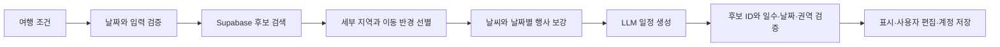
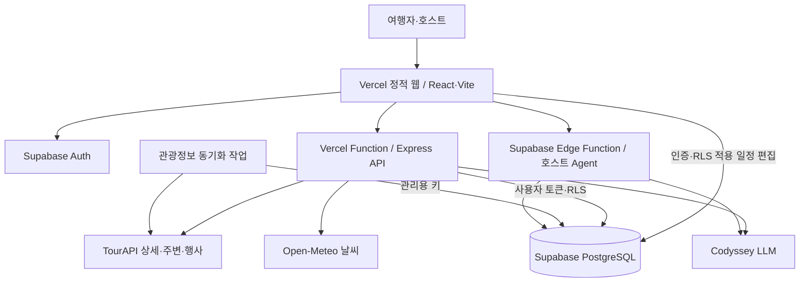
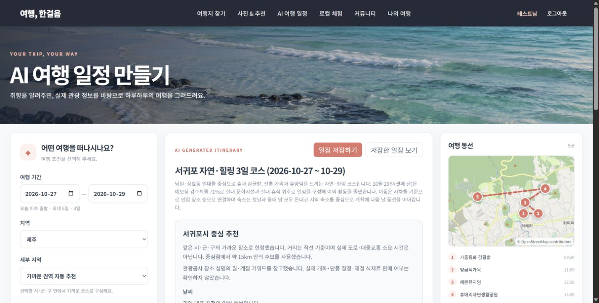
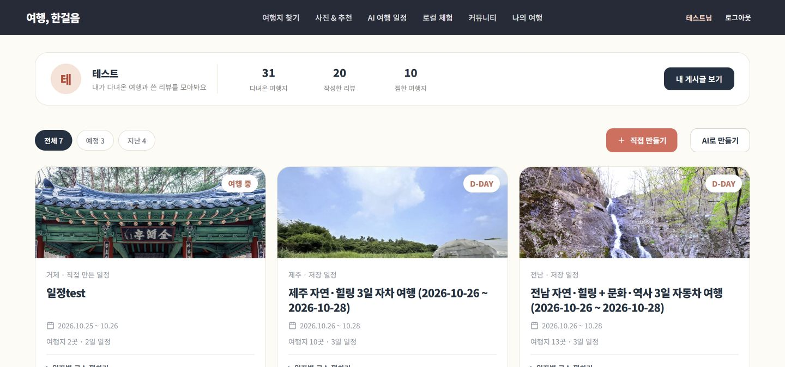

# 여행, 한걸음

**AI 기반 국내 여행지 추천 및 여행 일정 계획 서비스**

개발 기간 **약 2주** · 팀 **5명**

**[공개 서비스 바로가기](https://ai-travel-planner-pi-indol.vercel.app)**

여행지를 찾는 순간부터 날짜별 계획, 저장, 여행 후 리뷰까지 연결하는 서비스입니다. 실제 관광정보를 바탕으로 AI 일정 초안을 만들거나, 원하는 장소를 직접 골라 나만의 일정을 작성할 수 있습니다. 지역 체험을 탐색하는 여행자와 체험을 기획·운영하는 호스트를 위한 기능도 제공합니다.

> 현재 실행 구조입니다. 인증과 데이터 저장은 **Supabase Auth·PostgreSQL**을 사용합니다. 저장소에 남아 있는 Oracle SQL·인수인계·관리 스크립트는 이전 구현 기록이며 현재 서버의 실행 경로가 아닙니다.

## 1. 문제 정의와 목표

관광지·음식점·숙소를 따로 찾고, 기간과 이동 수단에 맞춰 방문 순서를 정하는 데에는 많은 선택이 필요합니다. 도 단위로 추천한 장소가 서로 먼 도시에 흩어지거나, 추천받은 계획을 수정·저장하기 어려운 문제도 있습니다.

이 서비스는 **실제 장소를 탐색하고, 가까운 권역의 일정 초안을 만든 뒤 사용자가 직접 조정하는 흐름**을 제공합니다.

| 사용자 문제 | 해결 방식 |
| --- | --- |
| 어디로 갈지 정하기 어려움 | 지역·키워드 검색, 사진과 상세 정보, 최근 검색 기반 추천 |
| 일정 초안을 만들기 어려움 | 기간·지역·예산·인원·이동 수단·스타일을 반영한 AI 생성 |
| 서로 먼 도시를 오가는 코스 | 세부 지역과 좌표를 이용한 가까운 권역의 후보 선별 |
| AI 결과를 원하는 대로 바꾸고 싶음 | 장소 추가·삭제, 방문 시간·순서 편집, 직접 일정 작성 |
| 관심 장소와 여행 기록이 흩어짐 | 계정별 찜·일정 저장, 지난 일정 전체 보기와 장소별 리뷰 |
| 지역 체험 기획을 구체화하기 어려움 | 기존 체험·지역 지식·가치 평가·비용 계산을 활용한 호스트 Agent |

준비 시간 단축과 만족도 향상은 서비스 목표입니다. 실제 사용자 조사로 측정하지 않은 성과 수치를 기재하지 않습니다.

## 2. 팀 구성

| 팀원 | 담당 영역 |
| --- | --- |
| 강하연 | 로컬 체험 |
| 최인영 | 사진 및 추천 |
| 황재훈 | AI 여행 일정 |
| 김수민 | 커뮤니티 |
| 이충훈 | 로그인 및 데이터베이스 설계 |

각 영역을 공통 인증, 장소 식별자, 일정 저장 구조와 연결했습니다. 약 2주 동안 기능 개발과 데이터·인증 통합, 관광정보 수집, AI 일정 개선 및 회귀 검증을 진행했습니다. 개인별 작업 시간·커밋 비율과 날짜별 수행 내역은 별도 산정하지 않았습니다.

## 3. 주요 기능

### 여행지 탐색과 추천

- 한국관광공사에서 수집해 Supabase에 저장한 관광정보를 검색합니다.
- 여행지 목록은 지역·이름·주소 필터와 서버 페이지 조회를 사용하며 한 페이지에 24곳을 표시합니다.
- DB 장소 ID와 TourAPI 콘텐츠 ID를 구분하고, 사진·출처·상세 정보·주변 장소를 연결합니다.
- 최근 30일의 브라우저별 검색 조건을 이용해 후보에 점수를 부여하고 추천 이유를 표시합니다. 로그인 계정의 장기 대화 메모리와는 다릅니다.
- 메인 인기 여행지와 추이 그래프는 **전체 로그인 회원의 사이트 활동**을 집계합니다. 개인 검색 이력이나 관광공사의 인기도 통계가 아닙니다.
- 장소별 상세 그래프에서 최근 7일과 이전 7일의 검색 결과 포함 횟수·상세 조회 횟수를 비교합니다. 기록 없는 날은 0이며, 동일 회원·장소의 상세 조회는 30분 단위로 중복을 줄입니다.

### AI 여행 일정

- 국내 17개 시도 또는 전국, 세부 지역, 기간, 인원, 예산, 이동 수단, 여행 스타일을 입력합니다.
- 새 일정은 한국 시간 기준 오늘 이후 출발, 1~5일로 제한합니다. 인원은 1~10명, 스타일은 최대 4개입니다.
- 저장된 관광지·문화시설·음식점·숙박 후보를 같은 시·군·구와 가까운 권역으로 좁혀 모델에 전달합니다.
- 이동 수단에 따라 직선 반경 15km(자차), 8km(대중교통), 4km(도보·택시)를 적용합니다.
- 지원하는 예보 날짜에는 날씨를 참고하고, 개최 기간이 여행 날짜와 겹치는 행사만 후보로 사용합니다. 예보가 없거나 조회에 실패한 상태도 표시합니다.
- 생성 결과는 날짜별 타임라인·사진·추천 이유·위치 지도와 함께 표시하며 장소 추가·삭제, 방문 시간·순서를 편집할 수 있습니다.
- 실제 도로 이동시간, 영업 여부, 가격·예약 가능 여부는 검증한 결과가 아닙니다. 계절 키워드는 실제 개화·단풍 절정이나 제철 판매 여부의 확인을 의미하지 않습니다.

### 직접 만드는 일정과 나의 여행

- AI 없이 빈 일정을 만들고 여행지 찾기에서 원하는 일차에 장소를 담습니다.
- 날짜별 장소·시간·순서를 편집하고 Supabase에 저장합니다. 같은 일차의 장소 중복을 막고 저장 버전 충돌을 안내합니다.
- AI 일정과 직접 일정은 공통 저장 구조로 관리합니다. 로그인한 계정으로 저장한 일정을 다시 불러올 수 있습니다.
- 예전 브라우저 저장 일정은 성공적으로 계정에 이전한 뒤 로컬 백업을 제거합니다.
- 찜은 회원별 DB에 저장하며 여행지 목록·상세·나의 여행에서 연결됩니다.
- 종료일이 지난 일정을 여행 단위로 묶어 전체 날짜의 코스를 다시 보고, 각 장소에 리뷰를 작성합니다. 실제 방문 인증을 의미하지는 않습니다.
- 화면이 계속 늘어나지 않도록 일정 목록은 3개, 찜 목록은 6개 단위로 페이지를 나눕니다.

### 커뮤니티

- 여행 후기·질문·이야기, 댓글, 좋아요, 본인 글 삭제를 제공합니다.
- 리뷰에 장소와 별점을 연결하고 장소별 후기·사진을 확인합니다.
- Supabase 인증과 RLS로 작성자와 데이터 소유권을 확인합니다.

### 로그인과 로컬 체험

- 일반 서비스와 호스트 화면은 같은 Supabase Auth 이메일 계정을 사용합니다.
- 가입 화면은 활동명·이메일·비밀번호·확인·동의를 입력받습니다. 이메일 인증 여부는 Supabase Auth 프로젝트 설정에 따릅니다.
- 헤더는 로그인 상태에 따라 계정 이름과 로그아웃을 표시합니다.
- 로컬 체험은 목록·상세·회차·참가 조건·집결 정보·신청 흐름을 제공합니다. 한국어·영어·일본어 화면과 실제 진행 언어는 구분합니다.
- 일반 회원도 본인 호스트 프로필을 만들 수 있으며 신규 프로필은 비공개 승인 대기 상태입니다. 승인·운영 권한을 스스로 부여할 수 없습니다.
- 호스트는 본인 체험·회차·신청을 관리하고 AI 기획·진단을 이용합니다. 공개 운영과 데모 범위를 구분하며 실제 결제 기능으로 설명하지 않습니다.

## 4. AI 활용 방식과 기술적 의사결정

### 여행 일정: 검색 증강 생성 워크플로우



[`server/itinerary.js`](server/itinerary.js)와 [`server/itineraryContext.js`](server/itineraryContext.js)가 처리합니다. Codyssey의 OpenAI 호환 Chat Completions API를 사용하며 기본 모델은 `gpt-5-mini`입니다. 모델은 제공된 후보 ID만 선택하도록 요청하고, 서버는 실제 장소 정보와 다시 결합합니다.

실제 DB에서 검색한 정보를 생성의 근거로 전달하는 RAG 구조입니다. SQL 검색과 규칙 기반 선별을 사용하며 임베딩·벡터 DB는 사용하지 않습니다. 후보의 외부 설명은 지시문으로 취급하지 않도록 프롬프트를 구성합니다.

### 호스트: 도구를 활용하는 AI Agent

[`supabase/functions/local-eum-agent`](supabase/functions/local-eum-agent)는 승인·권한·소유권을 검증한 뒤 다음 네 도구를 순서대로 사용합니다.

| 도구 | 역할 |
| --- | --- |
| `search_existing_experiences` | 공개된 유사 체험 조회 |
| `retrieve_local_knowledge` | 출처가 있는 지역 지식 검색 |
| `evaluate_experience_value` | 체험 가치 평가와 서버 점수 계산 |
| `estimate_program_cost` | 인원·참가비·가정 비용을 이용한 계산 |

모델이 JSON 도구 인자를 제안하고 서버가 검증·조회·계산한 결과를 누적해 보고서를 생성하는 제한형 Agent입니다. 제공자의 네이티브 도구 호출 대신 일반 채팅 기반 어댑터를 사용하며, 기본 모델 설정은 `gpt-5.4-mini`입니다.

지역 지식은 키워드 기반으로 검색하고 실제 조회한 자료 ID와 출처만 인용하도록 검사합니다. 관찰 사실·가정·미확인을 구분하고, 결과를 운영 DB에 자동 덮어쓰지 않습니다. 호스트가 검토한 뒤 기존 저장 절차로 반영합니다.

과제의 필수 기술 요소는 **AI Agent와 RAG**로 설명할 수 있습니다. 사진을 표시하는 것만으로 멀티모달 AI를 사용했다고 주장하거나, 일반 일정 저장을 LLM 장기 메모리라고 설명하지 않습니다. 상세 설정은 [Agent 운영 안내](docs/local-eum/ai-agent-runbook.md)를 참고합니다.

### 설계 결정과 검증 계약

| 설계 결정 | 적용 이유 | 검증 경계 |
| --- | --- | --- |
| SQL 조건 검색과 규칙 기반 RAG | 지역·유형·공개 여부 등 정확한 조건과 좌표를 이용할 수 있음 | 의미 유사도나 임베딩 검색의 품질을 측정한 구조는 아님 |
| 모델에 허용 후보 ID 전달 | 생성 문장을 장소 기준 데이터와 분리 | 서버가 실제 후보와 재결합하고 유효 일차·권역을 검사 |
| 수집 작업과 화면 조회 분리 | 페이지 이동 때 외부 전체 목록을 다시 수집하지 않음 | 누락 상세·주변·행사·날씨의 외부 호출은 별도 |
| AI·직접 일정의 JSONB 공통 모델 | 날짜별 코스를 같은 나의 여행 흐름에서 관리 | 수동 편집은 버전 검사, AI 저장·열기는 소유권 RPC로 구분 |
| 제한형 호스트 Agent | 모델이 제안한 인자를 검사한 뒤 서버 도구만 실행 | 모델의 임의 도구 선택·외부 직접 실행을 허용하지 않음 |

일정 후보는 권역 선별 후 관광지·문화시설 최대 30곳, 음식점 12곳, 숙박 8곳, 행사 8곳으로 제한합니다. 자동 권역은 계절·스타일 키워드와 후보 밀도, 인근 행사 점수를 활용합니다. 이는 실제 이동 비용을 최소화한 최적 경로 해법이 아닙니다.

요구사항은 제출 명세의 `FR-01`~`FR-33`, `NFR-01`~`NFR-07`로 식별합니다. 정상 흐름뿐 아니라 인증 실패, 후보 부족, 예보 실패, 생성 형식 오류, 수동 편집 충돌과 수집 중단의 기대 동작을 정의했습니다. 성능 SLA·만족도·시간 절감은 측정 없이 확정 수치로 제시하지 않습니다.

## 5. 시스템 아키텍처와 데이터



| 영역 | 주요 저장 구조 |
| --- | --- |
| 인증·프로필 | Supabase Auth, `travel_profiles` |
| 장소·상세 | `comm_place`, `comm_place_tour_detail` |
| 계정 일정·찜 | `travel_itineraries`, `mytrip_plan`, `mytrip_place`, `mytrip_wish` |
| 커뮤니티 | `comm_post`, `comm_post_place`, `comm_post_image`, 댓글·좋아요 테이블 |
| 검색·활동 | `travel_search_log`, `travel_site_activity` |
| 관광 원본·동기화 | `travel_tour_source`, `travel_tour_sync_state` |
| 로컬 체험 | 기존 `lc_*` 호스트·체험·회차·신청 테이블 |

실제 Supabase 메타데이터를 확인한 공개 스키마는 **테이블 26개, 뷰 4개, 외래키 32개**입니다. 관리형 `auth.users`는 별도입니다. 26개 공개 테이블의 RLS 활성화를 확인했으며, 개별 정책의 전체 보안 감사 완료를 의미하지 않습니다.


전체 그림은 [SVG로 확대](database/design/erd-overview.svg)할 수 있습니다. [영역별 ERD와 전체 데이터 사전](database/ERD.md)에 모든 열·타입·NULL·PK·FK·UNIQUE·CHECK를 정리했습니다. **실선은 실제 FK**이며 `content_id`·`ext_key`·활동 JSON의 코드 매핑과 구분합니다.

일정의 날짜별 코스는 JSONB payload로 보관합니다. JSON 파일을 운영 저장소로 사용하지 않습니다. 일반 API는 사용자 토큰과 RLS를 적용하며, 서버 전용 키를 브라우저에 전달하지 않습니다.

### 관광정보 수집과 변경 갱신

- 최초 전체 페이지를 수집하고 `contentid`별 수정일·원본 해시·공개 상태를 저장합니다.
- 이후 변경 조회와 해시 비교로 달라진 행만 갱신합니다. 비공개 원본은 보존하되 새 목록·검색·추천 후보에서 제외합니다.
- 페이지 데이터와 다음 페이지 커서를 같은 트랜잭션으로 저장해 중단 후 재개합니다. 호출 한도 오류 시 반복 재시도하지 않고 종료합니다.
- 목록·검색·일정 후보는 저장된 DB를 읽습니다. 아직 없는 상세나 원천 변경으로 오래된 상세는 추가 조회 후 저장하며, 주변·행사·날씨는 외부 조회가 남아 있습니다.
- 전체 수집 확인 당시 원본은 69,208건, 공개 원본 49,595건, 관광지 분류 12,556곳입니다. 서로 다른 분류의 수치이며 고정된 운영 건수가 아닙니다.
- 변경 조회 확인에서는 후보 10건, 실제 변경 0건으로 정상 완료했습니다.

```powershell
npm run check:tourism
npm run sync:tourism
```

현재 예약 동기화는 로컬 Codex 실행 환경에 의존합니다. 공개 운영에서는 서버 스케줄러를 별도로 설정해야 합니다. [Supabase 전환·동기화 안내](docs/supabase-migration.md)의 최신 운영 절과 [마이그레이션](supabase/migrations)을 참고합니다.

## 6. 기술 스택

| 구분 | 기술 | 선택 이유 |
| --- | --- | --- |
| 화면 | React 19, React Router 7 | 검색·일정·기록·체험 화면을 컴포넌트와 경로로 분리 |
| 빌드 | Vite 8 | 개발 서버, API 프록시, 정적 산출물 생성 |
| API | Node.js, Express 5 | 외부 키 보관, 검색·AI 검증과 데이터 연결 |
| 인증·DB | Supabase Auth, PostgreSQL, RLS | 공통 계정과 관계형 데이터·소유권 관리 |
| 호스트 Agent | Supabase Edge Functions | 인증된 호스트 요청과 도구 실행을 서버에서 처리 |
| 관광·날씨 | TourAPI, Open-Meteo | 실제 장소와 날짜별 보조 정보 활용 |
| 지도 | OpenStreetMap, Kakao Maps | 일정 위치와 체험 집결 장소 표시 |
| 검증 | Node test runner, PGlite, Oxlint | 로직·로컬 PostgreSQL 권한·코드 검사 |

정확한 설치 버전은 [`package-lock.json`](package-lock.json)을 기준으로 합니다.

## 7. 개발 환경과 실행

### 환경 준비

Node.js는 설치된 Vite 8의 지원 범위를 충족해야 합니다. 의존성을 설치하고, 환경 파일이 없을 때만 예시를 복사합니다.

```powershell
npm ci
Copy-Item .env.example .env.local
```

이미 `.env.local`이 있으면 복사 명령을 생략하고 기존 설정을 유지합니다.

| 환경 변수 | 용도 |
| --- | --- |
| `VITE_SUPABASE_URL`, `VITE_SUPABASE_PUBLISHABLE_KEY` | 브라우저의 Supabase 프로젝트와 공개 키 |
| `SUPABASE_SECRET_KEY` | 서버 전용 관리·검색 이력·활동·관광정보 동기화 키 |
| `SUPABASE_URL`, `SUPABASE_PUBLISHABLE_KEY` | 선택적인 서버 설정, 없으면 대응하는 VITE 설정 사용 |
| `TRAVEL_SEARCH_DATA_SOURCE` | 기본 `database`, 직접 외부 검색 `tourapi`, 시연용 `example` |
| `TRAVEL_SEARCH_HISTORY_STORE` | 기본 `supabase`, 저장 끄기 `disabled` |
| `TOUR_API_SERVICE_KEY` | 공공데이터포털의 일반 디코딩 인증키 |
| `TOUR_API_BASE_URL`, `TOUR_API_MOBILE_APP` | 관광 API 주소와 앱 식별 설정 |
| `CODYSSEY_OPENAI_KEY` | 서버의 일정 생성용 키 |
| `CODYSSEY_BASE_URL`, `CODYSSEY_MODEL` | 선택적인 일정 AI 주소·모델 설정 |
| `TRAVEL_BROWSER_COOKIE_SECRET` | 운영 환경에서 필수인 고정 브라우저 쿠키 서명 비밀값 |
| `WEB_ORIGIN` | 허용할 웹 주소, 기본 `http://localhost:5173` |
| `VITE_KAKAO_MAP_JAVASCRIPT_KEY` | 선택적인 지도 키, 제공자에 허용 사이트 등록 필요 |

실제 키는 커밋하지 않습니다. 서버 Secret key와 모델 키에 `VITE_` 접두사를 붙이지 않습니다. 호스트 Agent의 키·허용 origin·배포 설정은 Express와 별도이며 [운영 안내](docs/local-eum/ai-agent-runbook.md)를 따릅니다.

새 Supabase 환경은 필요한 로컬 체험 스키마와 [`supabase/migrations`](supabase/migrations)의 전환 마이그레이션을 확인해 준비합니다. 이미 적용한 환경에 초기 SQL을 무조건 다시 실행하지 않습니다. 호스트 Agent에는 프로젝트·역할 검증이 있으므로 키 변경만으로 다른 환경 준비가 끝나지는 않습니다.

### 로컬 실행

한 터미널에서 화면과 API를 함께 실행합니다. API가 준비된 뒤 화면 서버를 시작하며, 종료하면 함께 실행한 서버도 종료합니다.

```powershell
npm run dev
```

화면과 API를 따로 실행하려면 두 터미널에서 아래 명령을 각각 사용합니다.

```powershell
npm run server
npm run dev:web
```

웹은 `http://localhost:5173`, API는 `http://localhost:3000`입니다. 개발 중 `/api`는 Vite 프록시를 통해 Express에 연결됩니다. 환경 설정을 바꾼 뒤에는 해당 서버를 재시작합니다.

## 8. 주요 화면과 API

| 화면 | 경로 |
| --- | --- |
| 메인·검색 | `/`, `/search` |
| 여행지 목록·상세 | `/places`, `/places/:id`, `/places/tourapi/:id` |
| 장소별 활동 추이 | `/trending/:id` |
| AI 일정 | `/ai-itinerary` |
| 직접 일정 생성·편집 | `/mytrip/new`, `/mytrip/edit/:id` |
| 나의 여행 | `/mytrip` |
| 회원 | `/login`, `/signup` |
| 커뮤니티 | `/community`, `/community/write`, `/community/places/:id/reviews` |
| 로컬 체험 | `/local-eum`, `/local-eum/experiences/:experienceId` |
| 호스트 운영 | `/local-eum/host/profile`, `/local-eum/host/sessions/:sessionId/edit` |

| API | 처리 |
| --- | --- |
| `POST /api/search` | 검색·추천 순위·조건부 검색 이력 및 회원 활동 기록 |
| `GET /api/recommendations` | 최근 검색 조건 기반 추천 |
| `GET /api/places` | 저장된 관광지 페이지·검색·지역 필터 |
| `GET /api/places/:id`, `/api/places/tourapi/:id` | 장소 상세 |
| `GET /api/places/nearby` | 좌표 기반 주변 장소 |
| `GET /api/itineraries/status`, `/api/itineraries/districts` | AI 설정 상태·세부 지역 |
| `POST /api/itineraries/generate` | 후보 선별·AI 생성·검증 |
| `GET /api/mytrip/overview` | 계정별 일정·찜·지난 여행 |
| `GET`, `PUT /api/mytrip/wishes` | 찜 조회·저장·취소 |
| `GET /api/activity`, `/api/activity/place/:id` | 회원 전체 활동 추이·장소별 비교 |
| `POST /api/activity/view` | 인증된 회원의 상세 조회 기록 |
| `/api/community/*` | 글·댓글·좋아요·장소 검색·후기 |

로그인·회원가입 화면은 Supabase Auth SDK를 사용합니다. 직접 일정 편집과 AI 일정 저장 일부도 인증·RLS를 적용한 Supabase SDK/RPC 경로를 사용합니다. 상세 구현은 [`src/lib`](src/lib)과 [`server`](server)를 참고합니다.

## 9. 검증과 개선

```powershell
npm run test:travel
npm run test:supabase
node --test server/repositories/placeDetailRepository.test.js server/asyncTtlCache.test.js
node --test supabase/functions/local-eum-agent/*.test.mjs
npm run lint
npm run build
```

최근 충돌 통합 검증에서 `test:travel` 42개, `test:supabase` 40개, 장소 상세·캐시 8개가 통과했고 빌드도 성공했습니다. 호스트 Agent 모의 검사 16개와 로그인 오류 3개도 재실행해 통과했습니다. 묶음 간 일부 검사가 중복되므로 독립적인 테스트 총합으로 계산하지 않습니다. 이번 개정에서는 배포 진입점·라우팅 계약 2건도 통과했습니다. 존재하지 않던 로그인·가입 배경 이미지 참조는 제거했고, 초기 번들 크기 경고는 후속 최적화 대상으로 남아 있습니다. Lint는 오류 0건이며 기존 경고 13건이 남아 있습니다.

실제 Supabase·API 연동에서는 일정 저장·편집·재조회, 찜, 리뷰, 타인 데이터 접근 차단 및 실제 AI 생성의 샘플 요청을 확인했습니다. 통합 후 장소 검색과 ID 조회의 사진·좌표 연결도 확인했습니다. 실제 Chrome에서 AI 3일 일정 생성, 장소 추가 검색, 여행지 목록, 나의 여행, 지난 일정 전체 상세와 리뷰 연결, 커뮤니티, 체험·호스트 프로필을 확인하고 화면을 직접 촬영했습니다. 관광지 목록의 최초 요청 1회 실패 후 재조회 정상도 관찰했으며, 원인 재현과 응답시간 측정은 추가 대상입니다. 모든 화면의 모든 저장 동작을 완주한 시험이나 외부 사용자 사용성 평가를 의미하지 않습니다.

실제 DB를 수정하고 정리하는 테스트는 기본 실행에서 건너뜁니다. 서버와 테스트 환경을 준비한 뒤 명시적으로 실행합니다. 두 번째 검사는 실제 모델 호출도 포함합니다.

```powershell
$env:RUN_SUPABASE_INTEGRATION='1'
node --test server/supabase.integration.test.js
Remove-Item Env:RUN_SUPABASE_INTEGRATION
$env:RUN_PLANNER_LIVE='1'
node --test server/plannerFlow.integration.test.js
Remove-Item Env:RUN_PLANNER_LIVE
```

### 개발 중 피드백 반영

| 요청·문제 | 개선 |
| --- | --- |
| AI 일정과 찜이 나의 여행에 연결되지 않음 | 계정별 Supabase 저장·목록·다시 열기 통합 |
| 먼 도시를 오가는 추천 | 시·군·구와 이동 반경을 적용한 후보 선별 |
| 과거 날짜로 새 일정 생성 가능 | 화면 최소 날짜와 서버 검증 |
| 지난 여행이 장소별로 반복 표시됨 | 여행 단위 카드와 전체 일정 상세 |
| AI 없이 직접 계획하고 싶음 | 빈 일정 생성과 일차별 장소 담기·편집 |
| 일정과 찜이 많으면 화면이 계속 늘어남 | 목록 페이지 분할 |
| 헤더 인증 표시와 별도 호스트 로그인 혼선 | 공통 인증·계정 이름·로그아웃 표시 |

이는 개발 과정에서 수집한 개선 의견입니다. 외부 사용자 5명 이상의 검증 결과를 의미하지 않습니다.

## 10. 배포와 사용자 검증

Vercel의 **Vite 정적 화면 + Express API Function**으로 배포하도록 설정했습니다. `api/index.js`가 `server/app.js`를 내보내고, 로컬 `server/server.js`만 포트를 엽니다. `/api/*`를 먼저 처리한 뒤 모든 화면 경로를 SPA로 전달합니다. 공개 서비스에서도 Supabase Auth·DB·호스트 Edge Function을 사용합니다.

[배포 설정과 수용 검사 안내](docs/vercel-deployment.md)에 환경 변수, Auth URL, API 200/404/401 검사, 장시간 수집 작업 분리를 정리했습니다. `chlee` 작업 폴더를 Vercel Production에 직접 배포했습니다. [공개 주소](https://ai-travel-planner-pi-indol.vercel.app)에서 웹 화면, API health 200, 없는 API 404 JSON, 비로그인 나의 여행 401, DB 관광지 12,556곳 조회와 AI 설정 연결을 확인했습니다. 서버 비밀값은 Vercel의 서버 환경 변수로 등록했습니다. 공개 주소의 브라우저에서도 실제 제주 3일 AI 일정 생성에 성공했습니다.

원본 `inyoung7-lab/AI-Travel-Planner`와 Vercel 계정 `birdcross` 사이의 **Git 자동 배포 연결은 권한 제한으로 미완료**입니다. 현재 배포는 CLI에서 수행했으며 저장소 소유자의 Vercel GitHub 연동 승인이 필요합니다. 호스트 Agent의 공개 도메인 등록도 Supabase 프로젝트 관리자가 `LOCAL_EUM_ALLOWED_ORIGINS`에 위 주소를 추가해야 합니다. 현재 계정에는 Edge Secrets 관리 권한이 없어 설정을 변경하지 않았습니다.

운영 환경에서는 HTTPS, Supabase Auth URL·리다이렉트, 웹/API 허용 origin, 서버 비밀값, 고정 쿠키 서명값, RLS, 관광정보 예약 동기화를 확인합니다. 회원 동의 문구·정책과 동의 이력 보관 범위도 운영 요구사항에 맞춰 점검합니다.

공개 서비스 주소는 위에 기록했습니다. 외부 사용자 5명 이상의 실제 테스트 결과는 아직 확정하지 않았습니다. 실제 참가자에게 탐색·찜·AI 생성·직접 편집·저장·리뷰 과제를 제공하고, 완료 여부·시간·막힌 단계·의견을 기록해 개선 전후를 비교합니다. 테스트 보고서에는 자동 검사와 API·DB 연동 검증을 정리하고, 피드백 문서는 별도 항목으로 연결했습니다.

## 11. 관련 문서

5가지 사용자 관점의 모의 점검 결과와 개선 제안은 [기능 점검 및 개선 의견](docs/ai-persona-evaluation.md)에 정리했습니다. 실제 사용자 5명의 피드백과는 구분합니다.

### 최종 기획·발표 자료

- [프로젝트 기획서 PDF](deliverables/final-project-20261025/01_프로젝트_기획서.pdf)
- [기능요구명세서·아키텍처 PDF](deliverables/final-project-20261025/02_기능요구명세서_아키텍처.pdf)
- [테스트 보고서 PDF](deliverables/final-project-20261025/03_테스트_보고서.pdf)
- [피드백](docs/ai-persona-evaluation.md)
- [발표 PowerPoint 30장](deliverables/final-project-20261025/04_프로젝트_기획발표.pptx)
- [데이터베이스 설계서 PDF](deliverables/final-project-20261025/05_데이터베이스_설계서.pdf)
- [실제 기능 화면 가이드](docs/feature-screens.md)
- [자료 안내](deliverables/final-project-20261025/자료_안내.md)

제출 자료에는 개발 기간 약 2주, SQL 조건 기반 RAG, 데이터·권한 경계 및 검증 추적, 실제 촬영 화면, 전체 DB 관계도와 Vercel 운영 구성을 반영했습니다. 외부 사용자 테스트는 미실시 상태와 실제 기록 양식을 구분했습니다. 별도 발표자 대본 파일은 제외하고 PPT 노트에는 출처와 해석에 필요한 주석만 남겼습니다.

### 구현·운영 참고

- [현재 Supabase 전환·데이터 동기화·검증 기록](docs/supabase-migration.md)
- [현재 DB 관계도](database/ERD.md)
- [로컬 체험 안내](docs/local-eum/README.md)
- [호스트 Agent 운영 안내](docs/local-eum/ai-agent-runbook.md)
- [로컬 체험 Supabase 설정](docs/local-eum/supabase-setup-guide.md)
- [호스트 운영 가이드](docs/local-eum/host-operations-guide.md)

초기 설계 문서와 Oracle 인수인계 자료에는 전환 전 설명이 남아 있을 수 있습니다. 현재 실행·인증·저장은 이 README와 Supabase 전환 안내의 최신 운영 설명을 우선합니다. 발표·제출 자료는 별도 제작한 기획서·요구명세서·테스트 보고서·PPT 패키지로 관리합니다.

## 12. 실제 화면과 현재 제공 범위





위 화면은 개발 환경에서 테스트 계정으로 촬영했습니다. [전체 화면 가이드](docs/feature-screens.md)에서 탐색·직접 작성·리뷰·체험의 입력과 결과를 확인할 수 있습니다.

- 커뮤니티의 기존 사진과 샘플 사진은 표시하지만 **리뷰 작성 화면의 새 사진 업로드는 준비 중**입니다.
- 체험은 시연 데이터와 AI 생성 이미지 표시를 포함하며, 실제 결제·예약 확정 기능으로 안내하지 않습니다.
- 날씨·행사·계절은 확보한 정보만 참고합니다. 실제 도로 이동시간과 운영 여부를 확정하지 않습니다.
- 배포 후 기본 연결 검사는 수행했습니다. 전체 기능의 저장·복구·호스트 운영 검수와 외부 사용자 5명 이상의 테스트는 후속 대상입니다.
