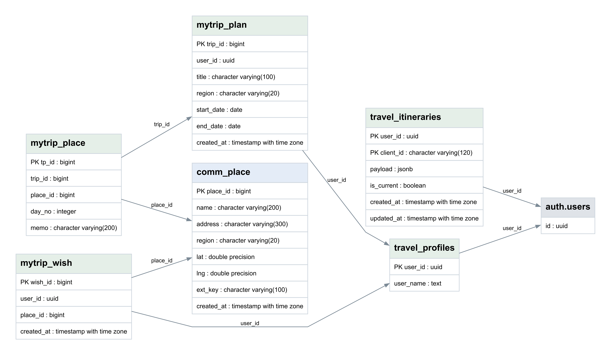
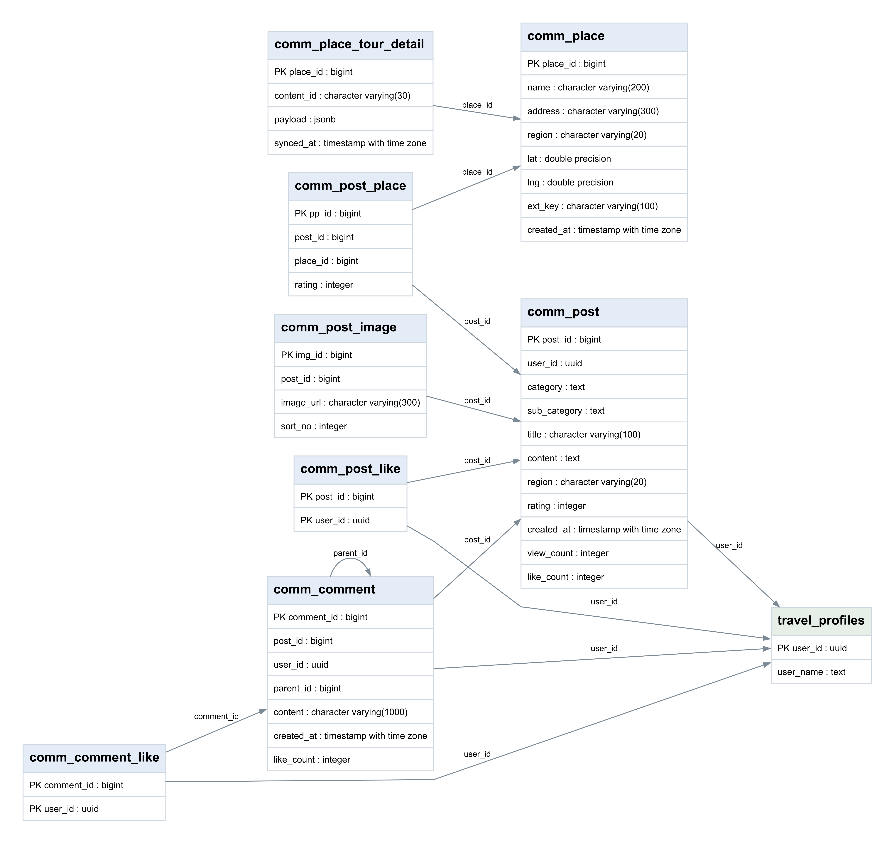
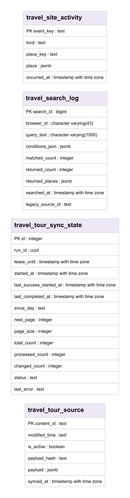

# 데이터베이스 설계

2026-10-26 실제 Supabase 메타데이터 조회 기준. 공개 스키마 테이블 **26개**, 뷰 **4개**. 모든 공개 테이블에 RLS가 활성화되어 있습니다. RLS 활성화만으로 개별 정책의 적정성이 입증되는 것은 아닙니다. 관리형 `auth.users`는 별도 표시합니다. 실선은 실제 FK이며 화살표는 참조하는 자식에서 부모로 향합니다.

## 영역별 관계도

### 회원·일정·찜

[확대 가능한 SVG](design/erd-travel.svg)

### 장소·커뮤니티

[확대 가능한 SVG](design/erd-community.svg)

### 로컬 체험·호스트·신청

[확대 가능한 SVG](design/erd-local.svg)

### 관광 원본·수집 상태·활동 기록

[확대 가능한 SVG](design/erd-pipeline.svg)

## 설계상 구분

- `travel_itineraries`의 복합 PK `(user_id, client_id)`와 JSONB payload가 AI·수동 일정의 공통 저장 구조입니다. `mytrip_plan`, `mytrip_place`는 별도 관계형 여행 기록 구조로 병존합니다. 자동으로 동기화된 동일 테이블로 설명하지 않습니다.
- `travel_tour_source.content_id`와 `comm_place.ext_key`, 상세 캐시의 `content_id` 연결은 애플리케이션의 논리 매핑입니다. 실제 FK가 없으므로 ERD 실선으로 그리지 않았습니다.
- `travel_site_activity`와 `travel_search_log`의 장소·사용자 연관은 해시/JSON 기반입니다. 회원 FK와 혼동하지 않습니다.
- `lc_experiences(venue_place_id,host_id)`는 `lc_places(place_id,owner_host_id)`를 복합 참조하여 장소 소유 호스트 일치를 보장합니다.
- 체험 신청은 신청자 이름·이메일·전화와 동의 기록을 `lc_applications`에 보관합니다. 공개 응답에 연락처를 노출하지 않도록 API·RLS 접근 정책을 함께 관리해야 합니다.
- 결제는 `DEMO_VIRTUAL_ACCOUNT`·`DEMO_ONLY` 계약의 데모입니다. 실제 정산·결제 승인 시스템을 구현한 것으로 설명하지 않습니다.

## 뷰

- `travel_saved_tour_catalog`
- `community_posts`
- `community_comments`
- `community_place_reviews`

## 전체 데이터 사전

### `travel_itineraries`

| 열 | PostgreSQL 타입 | NULL 허용 |
| --- | --- | --- |
| user_id | uuid | 아니오 |
| client_id | character varying(120) | 아니오 |
| payload | jsonb | 아니오 |
| is_current | boolean | 아니오 |
| created_at | timestamp with time zone | 아니오 |
| updated_at | timestamp with time zone | 아니오 |

**제약 조건**

- `PRIMARY KEY (user_id, client_id)`
- `FOREIGN KEY (user_id) REFERENCES auth.users(id) ON DELETE CASCADE`
- `CHECK (((length(btrim((client_id)::text)) >= 1) AND (length(btrim((client_id)::text)) <= 120)))`
- `CHECK ((COALESCE(((jsonb_typeof(payload) = 'object'::text) AND (jsonb_typeof((payload -> 'days'::text)) = 'array'::text) AND ((jsonb_array_length((payload -> 'days'::text)) >= 1) AND (jsonb_array_length((payload -> 'days'::text)) <= 5))), false) AND (octet_length((payload)::text) <= 262144)))`

### `travel_site_activity`

| 열 | PostgreSQL 타입 | NULL 허용 |
| --- | --- | --- |
| event_key | text | 아니오 |
| kind | text | 아니오 |
| place_key | text | 예 |
| place | jsonb | 예 |
| occurred_at | timestamp with time zone | 아니오 |

**제약 조건**

- `CHECK ((((kind = 'search'::text) AND (place_key IS NULL)) OR ((kind = ANY (ARRAY['result'::text, 'view'::text])) AND (place_key IS NOT NULL) AND (place IS NOT NULL))))`
- `CHECK ((kind = ANY (ARRAY['search'::text, 'result'::text, 'view'::text])))`
- `PRIMARY KEY (event_key)`

### `travel_tour_source`

| 열 | PostgreSQL 타입 | NULL 허용 |
| --- | --- | --- |
| content_id | text | 아니오 |
| modified_time | text | 아니오 |
| is_active | boolean | 아니오 |
| payload_hash | text | 아니오 |
| payload | jsonb | 아니오 |
| synced_at | timestamp with time zone | 아니오 |

**제약 조건**

- `PRIMARY KEY (content_id)`

### `travel_tour_sync_state`

| 열 | PostgreSQL 타입 | NULL 허용 |
| --- | --- | --- |
| id | integer | 아니오 |
| run_id | uuid | 예 |
| lease_until | timestamp with time zone | 예 |
| started_at | timestamp with time zone | 예 |
| last_success_started_at | timestamp with time zone | 예 |
| last_completed_at | timestamp with time zone | 예 |
| since_day | text | 예 |
| next_page | integer | 아니오 |
| page_size | integer | 아니오 |
| total_count | integer | 아니오 |
| processed_count | integer | 아니오 |
| changed_count | integer | 아니오 |
| status | text | 아니오 |
| last_error | text | 예 |

**제약 조건**

- `CHECK ((id = 1))`
- `PRIMARY KEY (id)`

### `lc_hosts`

| 열 | PostgreSQL 타입 | NULL 허용 |
| --- | --- | --- |
| host_id | bigint | 아니오 |
| auth_user_id | uuid | 예 |
| display_name | text | 아니오 |
| bio | text | 예 |
| page_slug | text | 예 |
| approval_status | text | 아니오 |
| is_public | boolean | 아니오 |
| created_at | timestamp with time zone | 아니오 |
| host_studio_title | text | 아니오 |
| host_studio_description | text | 아니오 |
| translations | jsonb | 아니오 |

**제약 조건**

- `CHECK ((approval_status = ANY (ARRAY['PENDING'::text, 'APPROVED'::text, 'SUSPENDED'::text])))`
- `CHECK (((approval_status <> 'APPROVED'::text) OR (auth_user_id IS NOT NULL)))`
- `FOREIGN KEY (auth_user_id) REFERENCES auth.users(id) ON DELETE RESTRICT`
- `UNIQUE (auth_user_id)`
- `CHECK (((char_length(btrim(display_name)) >= 1) AND (char_length(btrim(display_name)) <= 80)))`
- `CHECK (((char_length(btrim(host_studio_description)) >= 1) AND (char_length(btrim(host_studio_description)) <= 240)))`
- `CHECK (((char_length(btrim(host_studio_title)) >= 1) AND (char_length(btrim(host_studio_title)) <= 80)))`
- `CHECK ((page_slug ~ '^[a-z0-9]+(?:-[a-z0-9]+)*$'::text))`
- `UNIQUE (page_slug)`
- `PRIMARY KEY (host_id)`
- `CHECK (((NOT is_public) OR (approval_status = 'APPROVED'::text)))`
- `CHECK (((jsonb_typeof(translations) = 'object'::text) AND (((translations - 'en'::text) - 'ja'::text) = '{}'::jsonb) AND ((NOT (translations ? 'en'::text)) OR ((jsonb_typeof((translations -> 'en'::text)) = 'object'::text) AND (COALESCE(((translations -> 'en'::text) ->> 'review_status'::text), 'DRAFT'::text) = ANY (ARRAY['DRAFT'::text, 'REVIEWED'::text])))) AND ((NOT (translations ? 'ja'::text)) OR ((jsonb_typeof((translations -> 'ja'::text)) = 'object'::text) AND (COALESCE(((translations -> 'ja'::text) ->> 'review_status'::text), 'DRAFT'::text) = ANY (ARRAY['DRAFT'::text, 'REVIEWED'::text]))))))`

### `lc_user_roles`

| 열 | PostgreSQL 타입 | NULL 허용 |
| --- | --- | --- |
| user_id | uuid | 아니오 |
| role | text | 아니오 |
| assigned_at | timestamp with time zone | 아니오 |
| assigned_by | uuid | 예 |

**제약 조건**

- `FOREIGN KEY (assigned_by) REFERENCES auth.users(id) ON DELETE SET NULL`
- `PRIMARY KEY (user_id, role)`
- `CHECK ((role = ANY (ARRAY['HOST'::text, 'ADMIN'::text])))`
- `FOREIGN KEY (user_id) REFERENCES auth.users(id) ON DELETE CASCADE`

### `lc_experience_steps`

| 열 | PostgreSQL 타입 | NULL 허용 |
| --- | --- | --- |
| step_id | bigint | 아니오 |
| experience_id | bigint | 아니오 |
| step_order | smallint | 아니오 |
| elapsed_min | integer | 아니오 |
| duration_min | integer | 아니오 |
| title | text | 아니오 |
| description | text | 예 |
| created_at | timestamp with time zone | 아니오 |
| updated_at | timestamp with time zone | 아니오 |
| translations | jsonb | 아니오 |

**제약 조건**

- `CHECK (((elapsed_min + duration_min) <= 1440))`
- `CHECK ((char_length(description) <= 4000))`
- `CHECK (((duration_min >= 1) AND (duration_min <= 1440)))`
- `CHECK (((elapsed_min >= 0) AND (elapsed_min <= 1439)))`
- `FOREIGN KEY (experience_id) REFERENCES lc_experiences(experience_id) ON DELETE RESTRICT`
- `UNIQUE (experience_id, step_order)`
- `PRIMARY KEY (step_id)`
- `CHECK (((step_order >= 1) AND (step_order <= 100)))`
- `CHECK (((char_length(btrim(title)) >= 1) AND (char_length(btrim(title)) <= 200)))`
- `CHECK (((jsonb_typeof(translations) = 'object'::text) AND (((translations - 'en'::text) - 'ja'::text) = '{}'::jsonb) AND ((NOT (translations ? 'en'::text)) OR ((jsonb_typeof((translations -> 'en'::text)) = 'object'::text) AND (COALESCE(((translations -> 'en'::text) ->> 'review_status'::text), 'DRAFT'::text) = ANY (ARRAY['DRAFT'::text, 'REVIEWED'::text])))) AND ((NOT (translations ? 'ja'::text)) OR ((jsonb_typeof((translations -> 'ja'::text)) = 'object'::text) AND (COALESCE(((translations -> 'ja'::text) ->> 'review_status'::text), 'DRAFT'::text) = ANY (ARRAY['DRAFT'::text, 'REVIEWED'::text]))))))`

### `lc_experiences`

| 열 | PostgreSQL 타입 | NULL 허용 |
| --- | --- | --- |
| experience_id | bigint | 아니오 |
| host_id | bigint | 아니오 |
| template_id | bigint | 아니오 |
| title | text | 아니오 |
| description | text | 예 |
| region_code | text | 예 |
| status | text | 아니오 |
| created_at | timestamp with time zone | 아니오 |
| detail_description | text | 예 |
| inclusions | text[] | 아니오 |
| preparation_items | text[] | 아니오 |
| precautions | text[] | 아니오 |
| hero_image_url | text | 예 |
| hero_image_alt | text | 예 |
| venue_place_id | bigint | 예 |
| updated_at | timestamp with time zone | 아니오 |
| is_demo | boolean | 아니오 |
| demo_code | text | 예 |
| translations | jsonb | 아니오 |
| available_languages | text[] | 아니오 |

**제약 조건**

- `CHECK (((available_languages <@ ARRAY['ko'::text, 'en'::text, 'ja'::text]) AND (array_position(available_languages, NULL::text) IS NULL)))`
- `CHECK ((demo_code ~ '^DEMO-[A-Z0-9-]{2,48}$'::text))`
- `UNIQUE (demo_code)`
- `CHECK (((demo_code IS NULL) OR is_demo))`
- `CHECK ((char_length(detail_description) <= 20000))`
- `CHECK (((char_length(btrim(hero_image_alt)) >= 1) AND (char_length(btrim(hero_image_alt)) <= 300)))`
- `CHECK (((char_length(hero_image_url) <= 2000) AND ((hero_image_url ~ '^https://[^[:space:]]+$'::text) OR (hero_image_url ~ '^/images/local-eum/[A-Za-z0-9_-]+[.](png|jpe?g|webp|avif)$'::text))))`
- `FOREIGN KEY (host_id) REFERENCES lc_hosts(host_id) ON DELETE RESTRICT`
- `CHECK (((hero_image_url IS NULL) OR (hero_image_alt IS NOT NULL)))`
- `CHECK (lc_private.lc_valid_detail_list(inclusions))`
- `PRIMARY KEY (experience_id)`
- `CHECK (lc_private.lc_valid_detail_list(precautions))`
- `CHECK (lc_private.lc_valid_detail_list(preparation_items))`
- `CHECK ((status = ANY (ARRAY['DRAFT'::text, 'PUBLISHED'::text, 'CANCELLED'::text])))`
- `FOREIGN KEY (template_id) REFERENCES lc_program_templates(template_id) ON DELETE RESTRICT`
- `CHECK (((char_length(btrim(title)) >= 1) AND (char_length(btrim(title)) <= 120)))`
- `CHECK (((jsonb_typeof(translations) = 'object'::text) AND (((translations - 'en'::text) - 'ja'::text) = '{}'::jsonb) AND ((NOT (translations ? 'en'::text)) OR ((jsonb_typeof((translations -> 'en'::text)) = 'object'::text) AND (COALESCE(((translations -> 'en'::text) ->> 'review_status'::text), 'DRAFT'::text) = ANY (ARRAY['DRAFT'::text, 'REVIEWED'::text])))) AND ((NOT (translations ? 'ja'::text)) OR ((jsonb_typeof((translations -> 'ja'::text)) = 'object'::text) AND (COALESCE(((translations -> 'ja'::text) ->> 'review_status'::text), 'DRAFT'::text) = ANY (ARRAY['DRAFT'::text, 'REVIEWED'::text]))))))`
- `FOREIGN KEY (venue_place_id, host_id) REFERENCES lc_places(place_id, owner_host_id) ON DELETE RESTRICT`

### `lc_places`

| 열 | PostgreSQL 타입 | NULL 허용 |
| --- | --- | --- |
| place_id | bigint | 아니오 |
| owner_host_id | bigint | 아니오 |
| place_name | text | 아니오 |
| road_address | text | 예 |
| address_detail | text | 예 |
| latitude | numeric(10,7) | 예 |
| longitude | numeric(10,7) | 예 |
| directions | text | 예 |
| map_provider | text | 아니오 |
| provider_place_id | text | 예 |
| map_url | text | 예 |
| coordinate_source | text | 예 |
| source_reference | text | 예 |
| is_confirmed | boolean | 아니오 |
| confirmed_at | timestamp with time zone | 예 |
| created_at | timestamp with time zone | 아니오 |
| updated_at | timestamp with time zone | 아니오 |
| seed_code | text | 예 |

**제약 조건**

- `CHECK ((char_length(address_detail) <= 200))`
- `CHECK ((((NOT is_confirmed) AND (confirmed_at IS NULL)) OR (is_confirmed AND (confirmed_at IS NOT NULL) AND (road_address IS NOT NULL))))`
- `CHECK (((latitude IS NULL) = (longitude IS NULL)))`
- `CHECK (((latitude IS NULL) OR ((coordinate_source IS NOT NULL) AND (source_reference IS NOT NULL))))`
- `CHECK ((coordinate_source = ANY (ARRAY['JUSO'::text, 'HOST_PROVIDED'::text, 'LICENSED'::text])))`
- `CHECK ((char_length(directions) <= 4000))`
- `UNIQUE (place_id, owner_host_id)`
- `CHECK (((latitude >= ('-90'::integer)::numeric) AND (latitude <= (90)::numeric)))`
- `CHECK (((longitude >= ('-180'::integer)::numeric) AND (longitude <= (180)::numeric)))`
- `CHECK ((map_provider = ANY (ARRAY['KAKAO'::text, 'NAVER'::text])))`
- `CHECK (((char_length(map_url) <= 2000) AND (map_url ~ '^https://(map[.]kakao[.]com|place[.]map[.]kakao[.]com|map[.]naver[.]com|naver[.]me)(/|$)'::text)))`
- `FOREIGN KEY (owner_host_id) REFERENCES lc_hosts(host_id) ON DELETE RESTRICT`
- `PRIMARY KEY (place_id)`
- `CHECK (((char_length(btrim(place_name)) >= 1) AND (char_length(btrim(place_name)) <= 200)))`
- `CHECK (((char_length(btrim(provider_place_id)) >= 1) AND (char_length(btrim(provider_place_id)) <= 200)))`
- `CHECK (((char_length(btrim(road_address)) >= 1) AND (char_length(btrim(road_address)) <= 500)))`
- `CHECK ((seed_code ~ '^LE-DEMO-[A-Z0-9-]+$'::text))`
- `UNIQUE (seed_code)`
- `CHECK (((char_length(btrim(source_reference)) >= 1) AND (char_length(btrim(source_reference)) <= 1000)))`

### `lc_program_templates`

| 열 | PostgreSQL 타입 | NULL 허용 |
| --- | --- | --- |
| template_id | bigint | 아니오 |
| title | text | 아니오 |
| description | text | 예 |
| duration_min | integer | 아니오 |
| default_fee_amount | integer | 아니오 |
| is_active | boolean | 아니오 |
| created_at | timestamp with time zone | 아니오 |
| seed_code | text | 예 |

**제약 조건**

- `CHECK ((default_fee_amount >= 0))`
- `CHECK (((duration_min >= 1) AND (duration_min <= 1440)))`
- `PRIMARY KEY (template_id)`
- `CHECK ((seed_code ~ '^LE-DEMO-[A-Z0-9-]+$'::text))`
- `UNIQUE (seed_code)`
- `CHECK (((char_length(btrim(title)) >= 1) AND (char_length(btrim(title)) <= 120)))`

### `lc_sessions`

| 열 | PostgreSQL 타입 | NULL 허용 |
| --- | --- | --- |
| session_id | bigint | 아니오 |
| experience_id | bigint | 아니오 |
| starts_at | timestamp with time zone | 아니오 |
| ends_at | timestamp with time zone | 아니오 |
| meeting_place | text | 아니오 |
| recruit_deadline | timestamp with time zone | 예 |
| min_people | integer | 아니오 |
| capacity | integer | 아니오 |
| fee_amount | integer | 아니오 |
| status | text | 아니오 |
| created_at | timestamp with time zone | 아니오 |
| updated_at | timestamp with time zone | 아니오 |
| meeting_place_id | bigint | 예 |
| seed_code | text | 예 |

**제약 조건**

- `CHECK ((capacity >= min_people))`
- `CHECK (((recruit_deadline IS NULL) OR (recruit_deadline <= starts_at)))`
- `FOREIGN KEY (experience_id) REFERENCES lc_experiences(experience_id) ON DELETE RESTRICT`
- `CHECK ((fee_amount >= 0))`
- `CHECK (((char_length(btrim(meeting_place)) >= 1) AND (char_length(btrim(meeting_place)) <= 200)))`
- `FOREIGN KEY (meeting_place_id) REFERENCES lc_places(place_id) ON DELETE RESTRICT`
- `CHECK ((min_people >= 1))`
- `PRIMARY KEY (session_id)`
- `CHECK ((seed_code ~ '^LE-DEMO-[A-Z0-9-]+$'::text))`
- `UNIQUE (seed_code)`
- `CHECK ((status = ANY (ARRAY['DRAFT'::text, 'RECRUITING'::text, 'CANCELLED'::text])))`
- `CHECK ((ends_at > starts_at))`

### `lc_applications`

| 열 | PostgreSQL 타입 | NULL 허용 |
| --- | --- | --- |
| application_id | bigint | 아니오 |
| receipt_code | text | 아니오 |
| auth_user_id | uuid | 예 |
| session_id | bigint | 아니오 |
| applicant_name | text | 아니오 |
| applicant_email | text | 아니오 |
| applicant_phone | text | 예 |
| contact_language | text | 아니오 |
| attendee_count | integer | 아니오 |
| note | text | 예 |
| privacy_notice_version | text | 아니오 |
| privacy_consented_at | timestamp with time zone | 아니오 |
| status | text | 아니오 |
| created_at | timestamp with time zone | 아니오 |
| expires_at | timestamp with time zone | 아니오 |

**제약 조건**

- `CHECK (((char_length(btrim(applicant_email)) >= 3) AND (char_length(btrim(applicant_email)) <= 254)))`
- `CHECK (((char_length(btrim(applicant_name)) >= 1) AND (char_length(btrim(applicant_name)) <= 80)))`
- `CHECK (((applicant_phone IS NULL) OR (char_length(applicant_phone) <= 40)))`
- `CHECK ((attendee_count >= 1))`
- `FOREIGN KEY (auth_user_id) REFERENCES auth.users(id) ON DELETE SET NULL`
- `CHECK ((contact_language = ANY (ARRAY['ko'::text, 'en'::text, 'ja'::text])))`
- `CHECK ((expires_at > created_at))`
- `CHECK (((note IS NULL) OR (char_length(note) <= 1000)))`
- `PRIMARY KEY (application_id)`
- `CHECK (((char_length(privacy_notice_version) >= 1) AND (char_length(privacy_notice_version) <= 40)))`
- `UNIQUE (receipt_code)`
- `FOREIGN KEY (session_id) REFERENCES lc_sessions(session_id) ON DELETE RESTRICT`
- `CHECK ((status = 'PENDING'::text))`

### `lc_application_payments`

| 열 | PostgreSQL 타입 | NULL 허용 |
| --- | --- | --- |
| payment_id | bigint | 아니오 |
| application_id | bigint | 아니오 |
| payment_method | text | 아니오 |
| amount | bigint | 아니오 |
| status | text | 아니오 |
| demo_reference | text | 아니오 |
| created_at | timestamp with time zone | 아니오 |
| expires_at | timestamp with time zone | 아니오 |

**제약 조건**

- `CHECK ((amount >= 0))`
- `FOREIGN KEY (application_id) REFERENCES lc_applications(application_id) ON DELETE RESTRICT`
- `UNIQUE (application_id)`
- `CHECK ((demo_reference ~ '^DEMO-[A-F0-9]{32}$'::text))`
- `UNIQUE (demo_reference)`
- `CHECK ((payment_method = 'DEMO_VIRTUAL_ACCOUNT'::text))`
- `PRIMARY KEY (payment_id)`
- `CHECK ((status = 'DEMO_ONLY'::text))`

### `travel_profiles`

| 열 | PostgreSQL 타입 | NULL 허용 |
| --- | --- | --- |
| user_id | uuid | 아니오 |
| user_name | text | 아니오 |

**제약 조건**

- `PRIMARY KEY (user_id)`
- `FOREIGN KEY (user_id) REFERENCES auth.users(id) ON DELETE CASCADE`
- `CHECK (((char_length(user_name) >= 1) AND (char_length(user_name) <= 100)))`

### `comm_place`

| 열 | PostgreSQL 타입 | NULL 허용 |
| --- | --- | --- |
| place_id | bigint | 아니오 |
| name | character varying(200) | 아니오 |
| address | character varying(300) | 예 |
| region | character varying(20) | 예 |
| lat | double precision | 예 |
| lng | double precision | 예 |
| ext_key | character varying(100) | 예 |
| created_at | timestamp with time zone | 아니오 |

**제약 조건**

- `UNIQUE (ext_key)`
- `CHECK (((lat >= ('-90'::integer)::double precision) AND (lat <= (90)::double precision)))`
- `CHECK (((lng >= ('-180'::integer)::double precision) AND (lng <= (180)::double precision)))`
- `PRIMARY KEY (place_id)`

### `comm_place_tour_detail`

| 열 | PostgreSQL 타입 | NULL 허용 |
| --- | --- | --- |
| place_id | bigint | 아니오 |
| content_id | character varying(30) | 아니오 |
| payload | jsonb | 아니오 |
| synced_at | timestamp with time zone | 아니오 |

**제약 조건**

- `PRIMARY KEY (place_id)`
- `FOREIGN KEY (place_id) REFERENCES comm_place(place_id) ON DELETE CASCADE`

### `travel_search_log`

| 열 | PostgreSQL 타입 | NULL 허용 |
| --- | --- | --- |
| search_id | bigint | 아니오 |
| browser_id | character varying(43) | 아니오 |
| query_text | character varying(1000) | 아니오 |
| conditions_json | jsonb | 아니오 |
| matched_count | integer | 아니오 |
| returned_count | integer | 아니오 |
| returned_places | jsonb | 아니오 |
| searched_at | timestamp with time zone | 아니오 |
| legacy_source_id | text | 예 |

**제약 조건**

- `CHECK (((returned_count >= 0) AND (returned_count <= matched_count)))`
- `CHECK ((jsonb_array_length(returned_places) = returned_count))`
- `UNIQUE (legacy_source_id)`
- `CHECK ((matched_count >= 0))`
- `PRIMARY KEY (search_id)`

### `comm_post_image`

| 열 | PostgreSQL 타입 | NULL 허용 |
| --- | --- | --- |
| img_id | bigint | 아니오 |
| post_id | bigint | 아니오 |
| image_url | character varying(300) | 아니오 |
| sort_no | integer | 아니오 |

**제약 조건**

- `PRIMARY KEY (img_id)`
- `FOREIGN KEY (post_id) REFERENCES comm_post(post_id) ON DELETE CASCADE`

### `comm_comment`

| 열 | PostgreSQL 타입 | NULL 허용 |
| --- | --- | --- |
| comment_id | bigint | 아니오 |
| post_id | bigint | 아니오 |
| user_id | uuid | 아니오 |
| parent_id | bigint | 예 |
| content | character varying(1000) | 아니오 |
| created_at | timestamp with time zone | 아니오 |
| like_count | integer | 아니오 |

**제약 조건**

- `CHECK ((length(btrim((content)::text)) > 0))`
- `FOREIGN KEY (parent_id) REFERENCES comm_comment(comment_id) ON DELETE CASCADE`
- `PRIMARY KEY (comment_id)`
- `FOREIGN KEY (post_id) REFERENCES comm_post(post_id) ON DELETE CASCADE`
- `FOREIGN KEY (user_id) REFERENCES travel_profiles(user_id) ON DELETE CASCADE`

### `mytrip_plan`

| 열 | PostgreSQL 타입 | NULL 허용 |
| --- | --- | --- |
| trip_id | bigint | 아니오 |
| user_id | uuid | 아니오 |
| title | character varying(100) | 아니오 |
| region | character varying(20) | 아니오 |
| start_date | date | 아니오 |
| end_date | date | 아니오 |
| created_at | timestamp with time zone | 아니오 |

**제약 조건**

- `CHECK ((end_date >= start_date))`
- `PRIMARY KEY (trip_id)`
- `FOREIGN KEY (user_id) REFERENCES travel_profiles(user_id) ON DELETE CASCADE`

### `mytrip_wish`

| 열 | PostgreSQL 타입 | NULL 허용 |
| --- | --- | --- |
| wish_id | bigint | 아니오 |
| user_id | uuid | 아니오 |
| place_id | bigint | 아니오 |
| created_at | timestamp with time zone | 아니오 |

**제약 조건**

- `PRIMARY KEY (wish_id)`
- `FOREIGN KEY (place_id) REFERENCES comm_place(place_id)`
- `FOREIGN KEY (user_id) REFERENCES travel_profiles(user_id) ON DELETE CASCADE`
- `UNIQUE (user_id, place_id)`

### `comm_post_like`

| 열 | PostgreSQL 타입 | NULL 허용 |
| --- | --- | --- |
| post_id | bigint | 아니오 |
| user_id | uuid | 아니오 |

**제약 조건**

- `PRIMARY KEY (post_id, user_id)`
- `FOREIGN KEY (post_id) REFERENCES comm_post(post_id) ON DELETE CASCADE`
- `FOREIGN KEY (user_id) REFERENCES travel_profiles(user_id) ON DELETE CASCADE`

### `comm_comment_like`

| 열 | PostgreSQL 타입 | NULL 허용 |
| --- | --- | --- |
| comment_id | bigint | 아니오 |
| user_id | uuid | 아니오 |

**제약 조건**

- `FOREIGN KEY (comment_id) REFERENCES comm_comment(comment_id) ON DELETE CASCADE`
- `PRIMARY KEY (comment_id, user_id)`
- `FOREIGN KEY (user_id) REFERENCES travel_profiles(user_id) ON DELETE CASCADE`

### `mytrip_place`

| 열 | PostgreSQL 타입 | NULL 허용 |
| --- | --- | --- |
| tp_id | bigint | 아니오 |
| trip_id | bigint | 아니오 |
| place_id | bigint | 아니오 |
| day_no | integer | 아니오 |
| memo | character varying(200) | 예 |

**제약 조건**

- `CHECK ((day_no >= 1))`
- `PRIMARY KEY (tp_id)`
- `FOREIGN KEY (place_id) REFERENCES comm_place(place_id)`
- `FOREIGN KEY (trip_id) REFERENCES mytrip_plan(trip_id) ON DELETE CASCADE`
- `UNIQUE (trip_id, place_id)`

### `comm_post`

| 열 | PostgreSQL 타입 | NULL 허용 |
| --- | --- | --- |
| post_id | bigint | 아니오 |
| user_id | uuid | 아니오 |
| category | text | 아니오 |
| sub_category | text | 예 |
| title | character varying(100) | 아니오 |
| content | text | 아니오 |
| region | character varying(20) | 예 |
| rating | integer | 예 |
| created_at | timestamp with time zone | 아니오 |
| view_count | integer | 아니오 |
| like_count | integer | 아니오 |

**제약 조건**

- `CHECK ((category = ANY (ARRAY['리뷰'::text, '질문'::text, '소통'::text])))`
- `CHECK (((length(btrim(content)) > 0) AND (octet_length(content) <= 3900)))`
- `PRIMARY KEY (post_id)`
- `CHECK (((rating >= 1) AND (rating <= 5)))`
- `CHECK ((sub_category = ANY (ARRAY['여행 리뷰'::text, '장소 리뷰'::text])))`
- `CHECK ((length(btrim((title)::text)) > 0))`
- `FOREIGN KEY (user_id) REFERENCES travel_profiles(user_id) ON DELETE CASCADE`

### `comm_post_place`

| 열 | PostgreSQL 타입 | NULL 허용 |
| --- | --- | --- |
| pp_id | bigint | 아니오 |
| post_id | bigint | 아니오 |
| place_id | bigint | 아니오 |
| rating | integer | 예 |

**제약 조건**

- `PRIMARY KEY (pp_id)`
- `FOREIGN KEY (place_id) REFERENCES comm_place(place_id)`
- `FOREIGN KEY (post_id) REFERENCES comm_post(post_id) ON DELETE CASCADE`
- `UNIQUE (post_id, place_id)`
- `CHECK (((rating >= 1) AND (rating <= 5)))`
