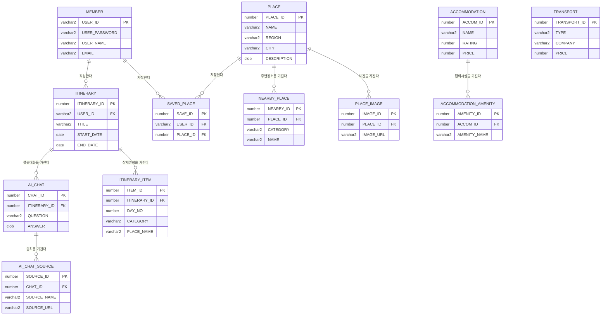

# 여행, 한국 (AI Travel Planner) - 데이터베이스 설계서 (ERD)

PPTX 화면 3장을 기준으로 설계한 Oracle 데이터베이스 구조입니다.
실제 테이블 생성 코드는 [`schema.sql`](./schema.sql) 파일을 참고하세요.

> **초심자 용어 정리**
> - **PK (기본 키)** : 각 행을 구분하는 고유번호. 중복되면 안 됩니다. (예: `PLACE_ID`)
> - **FK (외래 키)** : 다른 테이블을 가리키는 연결고리. (예: 사진이 "어느 여행지"의 것인지 가리킴)
> - **1 : N 관계** : "하나"에 "여러 개"가 딸린 관계. (여행지 1개 → 사진 여러 장)

---

## 전체 관계도 (ERD)

> 아래 다이어그램은 **GitHub에서 자동으로 그림으로 표시**됩니다.
> (로컬 편집기에서는 Mermaid 미리보기 확장을 설치하면 보입니다.)

> **TRANSPORT**(교통)는 다른 테이블과 직접 연결되지 않은 독립 비교 데이터입니다.
> 화면의 **"일정에 반영"** 버튼을 누르면 선택한 교통/숙소가 `ITINERARY_ITEM`에 새 행으로 추가됩니다.

---

## 슬라이드 1 — 여행지 상세 · 비교

| 테이블 | 역할 | 주요 관계 |
|--------|------|-----------|
| `PLACE` | 여행지 기본 정보 (협재해변 등) | 사진·주변장소의 부모 |
| `PLACE_IMAGE` | 여행지 사진 (1/12 슬라이드) | `PLACE` 1 : N |
| `NEARBY_PLACE` | 주변 추천 장소 (맛집/숙소/축제/가볼만한곳) | `PLACE` 1 : N |
| `SAVED_PLACE` | ♡ 저장하기 (즐겨찾기) | `MEMBER`·`PLACE` 연결 |

- **비슷한 여행지 비교** (협재해변 vs 함덕해변) 기능은 `PLACE` 테이블을 두 번 조회해 나란히 보여주는 것이라 별도 테이블이 필요 없습니다.

---

## 슬라이드 2 — AI 여행 일정 만들기

| 테이블 | 역할 | 주요 관계 |
|--------|------|-----------|
| `ITINERARY` | 여행 일정(입력 조건 + 묶음) | `MEMBER` 1 : N |
| `ITINERARY_ITEM` | 일차별 상세 일정 한 줄 한 줄 | `ITINERARY` 1 : N |
| `AI_CHAT` | AI 여행 도우미 질문/답변 | `ITINERARY` 1 : N |
| `AI_CHAT_SOURCE` | AI 답변의 참고 관광자료 링크 | `AI_CHAT` 1 : N |

---

## 슬라이드 3 — 교통 · 숙소 비교

| 테이블 | 역할 | 주요 관계 |
|--------|------|-----------|
| `TRANSPORT` | 교통편 비교 (버스/기차/항공/자차) | 독립 (참조 데이터) |
| `ACCOMMODATION` | 숙소 비교 정보 | 편의시설의 부모 |
| `ACCOMMODATION_AMENITY` | 숙소 편의시설 태그 | `ACCOMMODATION` 1 : N |

---

## 공통

| 테이블 | 역할 |
|--------|------|
| `MEMBER` | 회원 정보 (로그인/회원가입). **이미 생성되어 있음** — `server/login.js` 가 사용 중 |

---

## 실행 방법

1. Oracle 접속 후 `schema.sql` 을 엽니다.
2. 위에서부터 순서대로 실행합니다. (부모 테이블이 먼저 생성되어야 FK 오류가 안 납니다)
3. 처음부터 다시 만들려면 `schema.sql` 상단의 `DROP TABLE` 주석(`--`)을 풀고 먼저 실행하세요.
