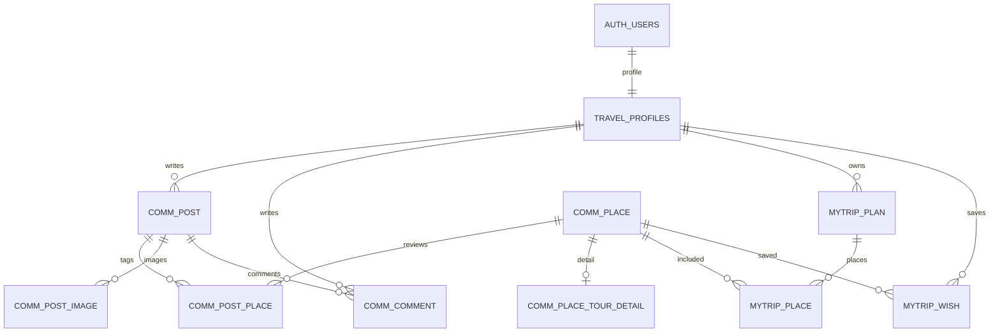

# Supabase 데이터 구조

인증 계정은 `auth.users.id`(UUID)로 통합합니다. 비밀번호는 Supabase Auth에서 관리합니다.

정확한 컬럼·제약·RLS·RPC는 [전환 마이그레이션](../supabase/migrations/202610250001_travel_supabase.sql)을 기준으로 합니다.
호스트 및 체험의 기존 `lc_*` 테이블은 그대로 사용하며 동일한 `auth.users.id`를 참조합니다.
검색 이력은 `travel_search_log`에 저장하며 서버가 검증한 브라우저 범위를 사용합니다. 일반 브라우저에는 조회 권한을 주지 않습니다.
