# 실제 기능 화면 가이드

이 문서는 여행지를 발견하고, AI 또는 직접 만든 일정에 담고, 여행 기록과 리뷰로 이어지는 사용 흐름을 설명합니다. 실제 서비스·개발 화면을 촬영했으며 화면에 표시된 계정은 테스트 계정입니다. 캡처에 보이는 일정·리뷰·체험 수는 촬영 시점의 데이터입니다.

**이미지는 클릭하면 원본 크기로 볼 수 있습니다.** 긴 페이지는 아래쪽 버튼과 목록까지 포함한 전체 화면으로 수록했습니다. 팝업은 내부 스크롤을 사용하는 화면이므로 해당 이미지의 표시 범위를 별도로 설명합니다. 서비스 화면을 보기 좋게 보이도록 합성하거나 기능 상태를 바꾸지는 않았습니다.

## 화면별 바로가기

| 단계 | 화면 | 주요 목적 |
| --- | --- | --- |
| 발견 | [추천 메인](#1-추천-메인) · [관광지 목록](#2-관광지-목록) · [활동 추이](#7-회원-활동-추이) | 인기 장소와 관광정보 탐색 |
| 계획 | [AI 일정](#3-ai-일정-생성) · [장소 추가](#4-일정에-장소-추가) · [직접 일정](#6-직접-일정-시작) | 여행 조건으로 코스 생성 또는 직접 구성 |
| 관리 | [나의 여행](#5-나의-여행) · [지난 일정](#11-지난-여행-전체-상세) | 계정에 저장한 일정과 찜 관리 |
| 공유 | [커뮤니티](#8-커뮤니티) · [장소별 리뷰](#12-장소별-리뷰) | 여행 후기·질문·소통 |
| 체험 | [로컬 체험](#9-로컬-체험) · [호스트 운영센터](#10-호스트-운영센터) | 지역 체험 탐색과 본인 호스트 정보 관리 |

## 1. 추천 메인

**진입:** 상단 ‘사진 & 추천’ 또는 서비스 로고. **이용:** 비로그인 상태에서도 탐색할 수 있습니다.

메인 상단의 검색창은 여행지 탐색의 출발점입니다. ‘요즘 뜨는 여행지’는 전체 로그인 회원의 최근 7일 검색 결과 포함 횟수와 상세 조회를 합산한 순위이며, 오른쪽 그래프는 일별 검색·조회 건수를 나누어 보여줍니다. 인기 카드의 본문을 누르면 해당 장소의 **상세 추이 그래프**로 이동합니다.

아래 추천 영역은 이용 기록에 따라 바뀝니다. 최근 브라우저 검색 정보가 있으면 그 정보를 반영한 추천을, 처음 방문한 경우에는 많이 조회된 여행지 또는 기본 여행지를 제공합니다. 카드 본문은 장소 상세로, 하트는 관심 여행지 저장으로 연결됩니다. 전체 회원 인기 순위와 개인의 최근 검색 기반 추천은 서로 다른 기준입니다.

| 화면 요소 | 사용 방법 | 확인할 결과 |
| --- | --- | --- |
| 여행지 검색 | 이름·지역 등 검색어를 입력하고 검색 | 조건에 맞는 여행지 탐색 |
| 인기 순위 카드 | 카드 본문 선택 | 장소별 검색·조회 비교 화면 |
| 아래 추천 카드 | 카드 본문 선택 | 사진·주소 등이 있는 장소 상세 |
| 하트 | 로그인 후 선택 | 계정의 찜 목록에 반영 |

[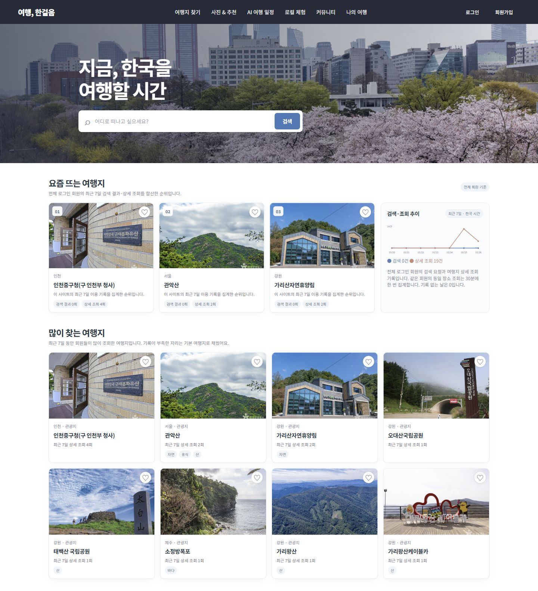](screenshots/01-home-full.jpg)

## 2. 관광지 목록

**진입:** 상단 ‘여행지 찾기’. **역할:** 한국관광공사에서 수집해 DB에 저장한 여행지를 검색·필터링하는 목록입니다. 화면 탐색과 관광정보 수집 작업은 분리합니다.

검색창에 이름·지역·주소를 입력하거나 지역 필터를 선택해 범위를 좁힙니다. 목록은 한 페이지에 24곳씩 보여주며 페이지를 이동해 나머지 장소를 확인합니다. 각 카드에서 사진과 장소명을 확인하고 상세 정보를 열거나, 로그인 후 하트로 찜합니다. 직접 일정에서 여행지 찾기를 열었을 때는 선택한 일정·일차에 장소를 담는 흐름으로 연결됩니다.

사진이 등록되지 않은 장소는 대체 영역을 표시합니다. 장소마다 서로 다른 관광정보와 사진을 사용하며, 임의의 동일 사진을 모든 카드에 적용하지 않습니다.

**이번 재촬영 확인:** 공개 서비스와 개발 서비스 모두 목록 조회 오류가 표시됐습니다. 따라서 과거 정상 화면을 현재 정상 동작의 증거로 바꾸어 넣지 않았습니다. 아래 정상 목록은 기존 촬영 자료이고, 현재 오류 화면은 별도로 남겼습니다.

기존 정상 목록 화면 참고

[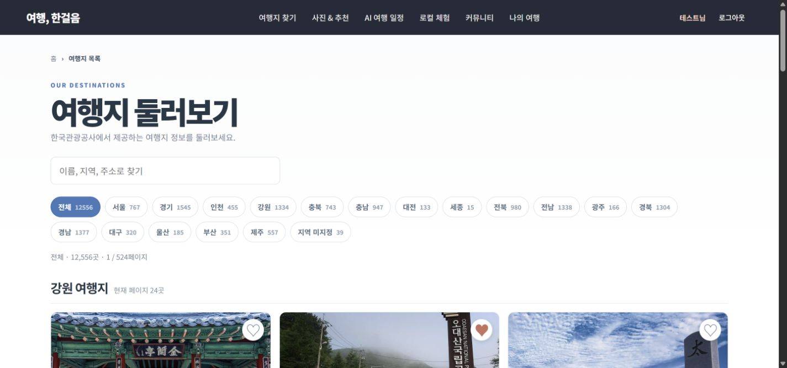](screenshots/02-places.jpg)

재촬영 중 확인한 목록 조회 오류

[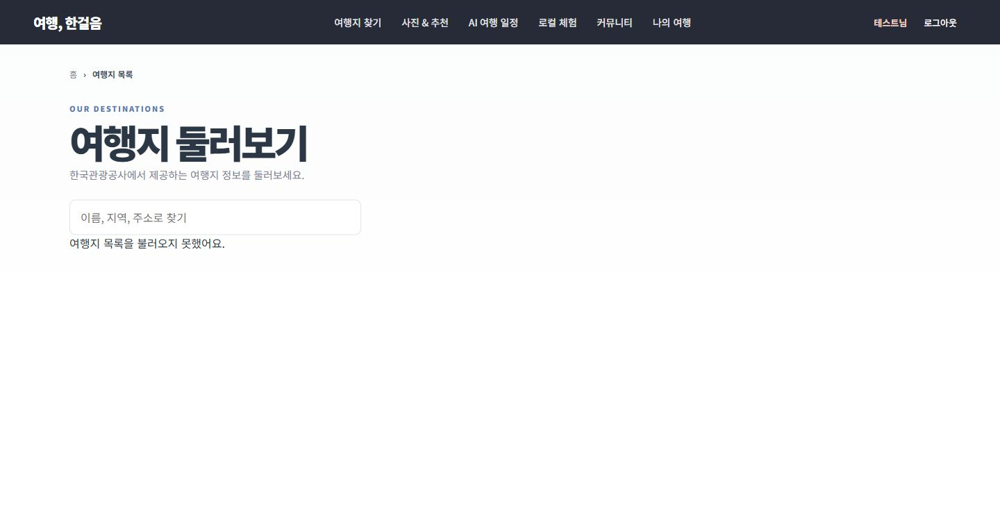](screenshots/02-places-load-error.jpg)

## 3. AI 일정 생성

**진입:** 상단 ‘AI 여행 일정’. **이용:** 생성은 비로그인 상태에서도 가능하며 계정 저장에는 로그인이 필요합니다.

왼쪽에서 여행 조건을 정하고 ‘내 여행 일정 만들기’를 누릅니다. 서버는 DB에 저장된 실제 관광정보에서 지역·위치·여행 조건에 맞는 후보를 찾고, LLM이 후보를 바탕으로 날짜별 코스와 추천 이유를 작성합니다. SQL 조건 기반 검색을 활용하며 벡터 임베딩을 필수로 사용하지 않습니다.

| 입력 항목 | 설정 내용 | 동작 기준 |
| --- | --- | --- |
| 여행 기간 | 출발일·도착일 | 한국 날짜 기준 과거 출발 제한, 최대 5일 |
| 지역·세부 지역 | 광역 지역과 시·군·구 또는 자동 추천 | 가까운 권역 중심으로 후보 구성 |
| 총 예산 | 1인 기준 참고 예산 | 확정 결제 금액이나 실시간 견적은 아님 |
| 인원·이동 수단 | 1~10명, 자차·대중교통·도보·택시 | 코스 구성 조건에 반영 |
| 여행 스타일 | 자연·힐링, 맛집 등 최대 4개 | 관심 유형에 맞는 후보와 설명 구성 |

결과 중앙에는 일정 제목·요약, 추천 권역, 날씨·행사 참고 정보와 일차별 코스가 표시됩니다. 날짜 탭을 바꾸면 해당 날의 방문 시간, 장소 사진, 추천 이유와 주소를 확인할 수 있습니다. 각 장소는 시간 변경, 순서 이동, 삭제가 가능하고 하단에서 장소를 추가할 수 있습니다. ‘일정 저장하기’는 편집한 일정을 계정에 저장하며, 비로그인이면 로그인 필요 메시지를 표시합니다.

오른쪽 지도는 장소의 실제 좌표와 방문 순서를 보여줍니다. 연결선은 위치 관계를 나타내며 실제 자동차·대중교통 경로가 아닙니다. 일별 날씨는 제공되는 예보 범위 안에서 활용하고, 행사는 등록 기간과 여행 기간이 겹치는 자료를 참고합니다. 계절 키워드만으로 실제 개화·단풍 절정이나 제철 식재료 판매를 보장하지 않습니다.

**캡처 읽기:** 제주 서귀포 권역의 생성 결과에서 조건 입력, 추천 근거, 1일차 전체 장소, 장소 추가 버튼과 지도까지 포함했습니다. AI 제안은 방문 전 운영 시간·요금·교통편을 다시 확인해야 합니다.

[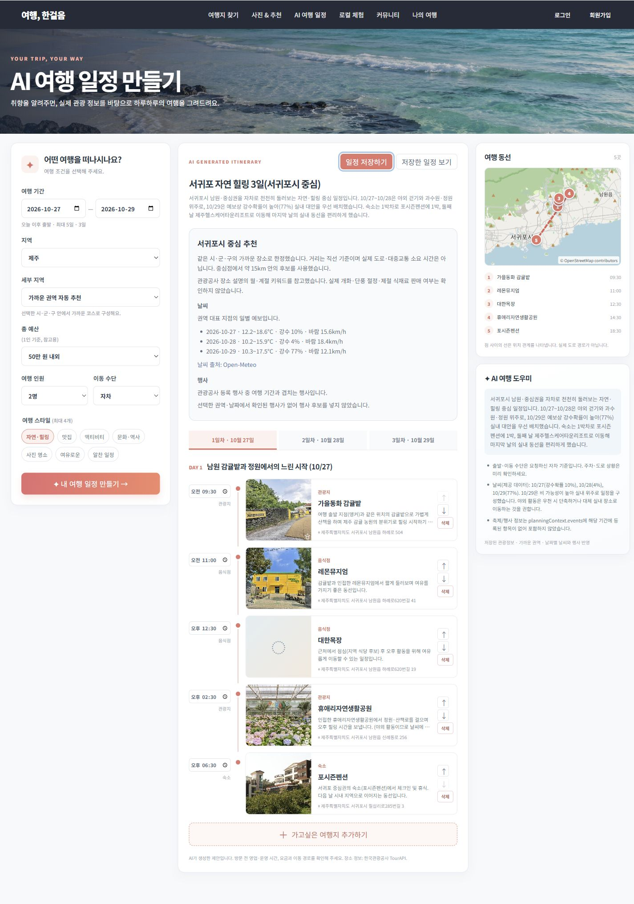](screenshots/03-ai-itinerary-full.jpg)

## 4. 일정에 장소 추가

**진입:** 생성 결과 하단 ‘가고싶은 여행지 추가하기’.

팝업 상단에는 장소를 추가할 일차와 날짜가 표시됩니다. 검색창에 여행지 이름 또는 주소를 입력하고 ‘검색’을 누르면 장소명·주소·사진이 있는 후보 목록을 확인합니다. 원하는 행의 ‘추가하기’를 선택하면 현재 일차의 코스에 담습니다. 일차를 잘못 선택했다면 먼저 팝업을 닫고 날짜 탭을 변경한 뒤 다시 열어 주세요.

추가 후에는 방문 시간과 순서를 조절하고 지도를 확인한 다음 일정을 저장합니다. 검색만 하거나 팝업을 닫는 동작은 회원의 저장된 일정을 변경하지 않습니다. 목록이 팝업 높이보다 길면 내부를 스크롤해 나머지 결과를 봅니다.

**캡처 읽기:** ‘서귀포’를 검색한 결과 팝업입니다. 제목·대상 날짜·검색창·후보별 추가 버튼을 보여줍니다. 팝업은 페이지 전체가 아닌 별도 스크롤 영역입니다. 촬영을 위해 추가·저장은 실행하지 않았습니다.

[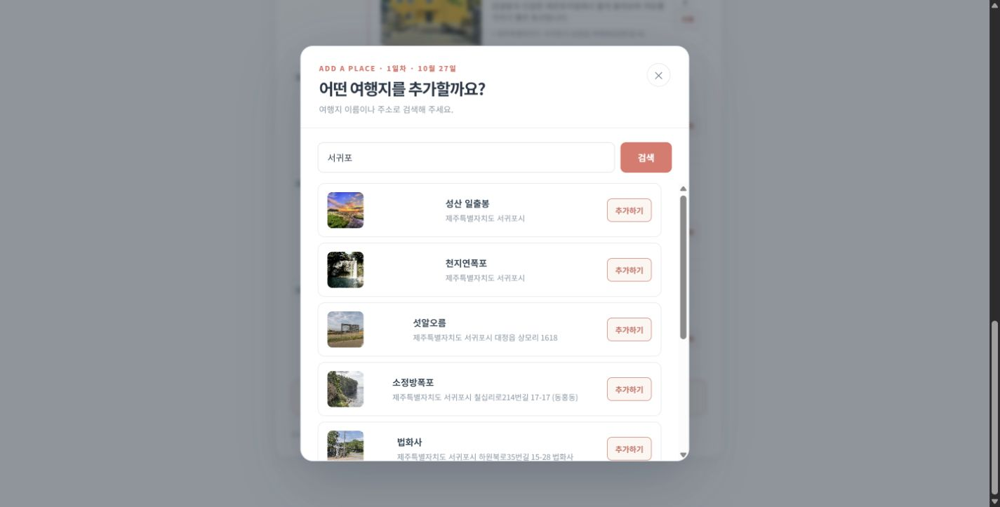](screenshots/04-itinerary-place-search-full.jpg)

## 5. 나의 여행

**진입:** 상단 ‘나의 여행’. **이용 조건:** 로그인한 본인 계정의 정보를 조회합니다.

상단에는 계정 이름과 여행·리뷰·찜 요약이 표시됩니다. 일정 목록에서는 AI로 저장한 일정과 직접 만든 일정을 함께 확인합니다. 카드의 제목, 기간, 장소 수와 여행 상태를 보고 ‘일정 보기’로 내용을 확인하거나 ‘편집’으로 이동합니다. ‘일자별 코스 펼치기’는 목록을 떠나지 않고 날짜별 코스를 간단히 확인하는 기능입니다.

| 영역 | 표시 내용 | 한 페이지 표시 수 |
| --- | --- | --- |
| 전체·예정·지난 일정 | 여행 단위 카드와 상세·편집 진입 | 3개 |
| 찜한 여행지 | 하트로 저장한 장소, 찜 취소·일정 추가 | 6곳 |
| 지난 여행 일정 | 종료일이 지난 저장 일정의 전체 상세 진입 | 3개 |

각 영역은 독립된 이전·다음 버튼으로 넘깁니다. 찜이나 지난 일정이 늘어도 모든 항목을 한 번에 길게 펼치지 않습니다. ‘직접 만들기’와 ‘AI로 만들기’는 각각 새 일정 작성 경로로 연결됩니다. 화면의 ‘지난 여행’은 저장된 일정 날짜에 따른 분류이며 실제 방문을 인증하는 기능은 아닙니다.

[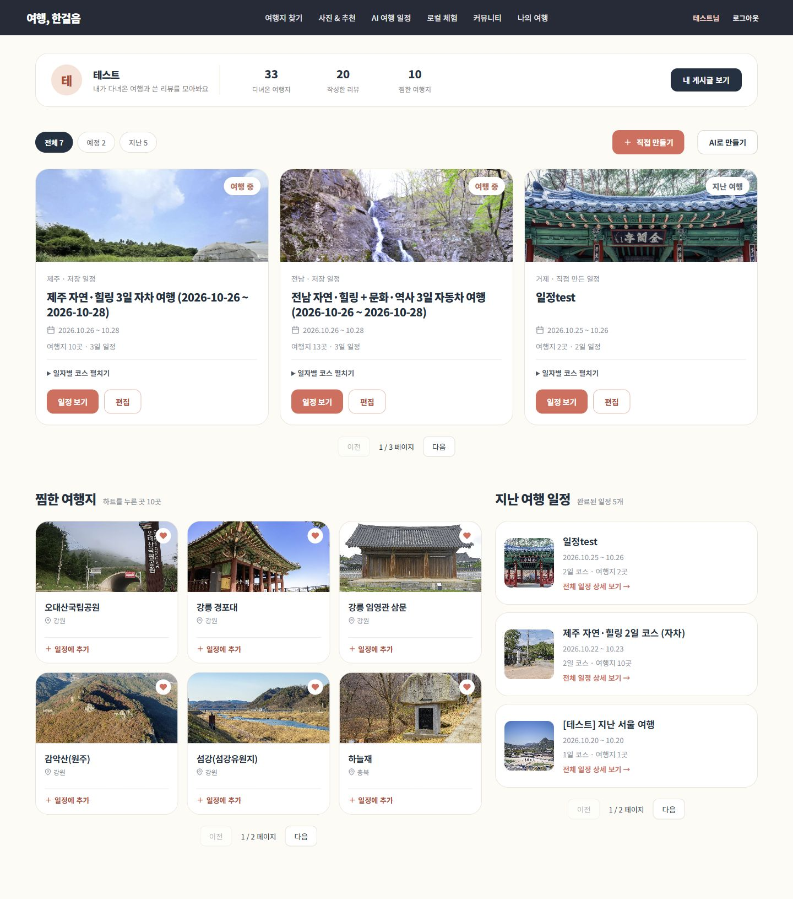](screenshots/05-mytrip-full.jpg)

## 6. 직접 일정 시작

**진입:** 나의 여행의 ‘직접 만들기’. **이용 조건:** 로그인 필요.

AI 생성 없이 사용자가 원하는 장소로 일정을 구성하는 시작 화면입니다. 일정 이름은 필수이고 여행 지역은 선택 입력입니다. 출발일과 도착일을 지정하고 ‘나만의 일정 시작하기’를 선택하면 빈 날짜별 계획을 계정에 만들고 편집 화면으로 이동합니다.

이후 ‘여행지 찾아 담기’로 관광지 목록을 열어 원하는 일차에 장소를 담습니다. 일차별로 방문 시간을 입력하고 위·아래 이동과 삭제로 동선을 다듬은 뒤 저장합니다. 편집 중 저장하지 않은 내용이 있으면 이동·로그아웃 시 확인 흐름을 제공합니다. AI로 만든 일정도 저장 후 공통 편집 흐름을 이용할 수 있습니다.

**캡처 읽기:** 이름·지역·날짜 입력부터 ‘장소 발견 → 일차별 배치 → 시간·순서 조절’ 안내까지 포함한 시작 화면입니다. 빈 일정을 추가로 저장하지 않고 촬영했습니다.

[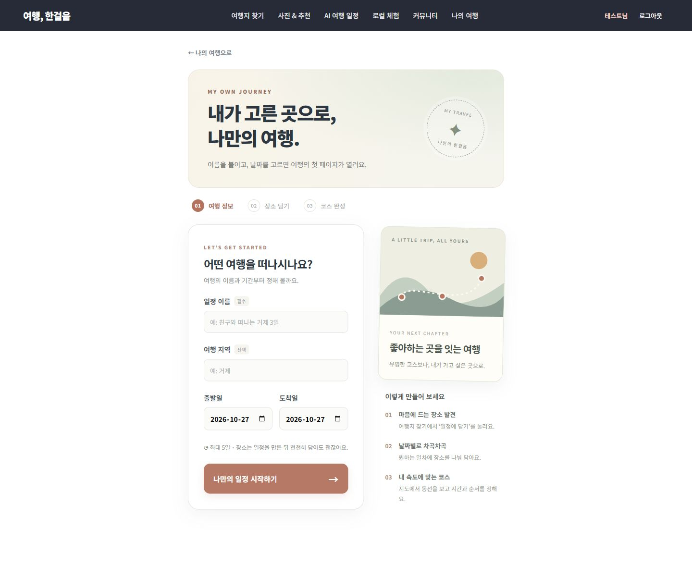](screenshots/06-manual-new-full.jpg)

## 7. 회원 활동 추이

**진입:** 메인 ‘요즘 뜨는 여행지’의 카드 본문. 관광지 상세 페이지와 별도의 통계 화면입니다.

선택한 여행지의 이전 7일과 최근 7일 활동을 비교합니다. ‘검색·조회 합계’, ‘검색 결과 포함’, ‘상세 조회’ 중 집계 항목을 선택해 그래프를 바꿉니다. 그래프 아래에는 기간별 합계, 변화율과 날짜별 상세 표가 있어 선 모양만으로 판단하지 않고 실제 건수를 확인할 수 있습니다.

| 지표 | 의미 |
| --- | --- |
| 검색 결과 포함 | 해당 여행지가 회원의 검색 결과에 포함된 횟수 |
| 상세 조회 | 회원이 해당 장소 상세를 열어 기록된 횟수 |
| 중복 처리 | 같은 회원·여행지의 상세 조회는 30분에 한 번 집계 |
| 기록 없는 날 | 0건 표시 |
| 이전 기간이 0건 | 증가율을 임의 계산하지 않고 비교 기준 없음 표시 |

개인의 검색 이력 화면이 아니라 전체 로그인 회원의 사이트 내 활동 집계입니다. 관광공사의 전국 검색량이나 관광객 방문 통계와는 다릅니다. 이번 사진은 그래프부터 날짜별 표, 하단 장소 정보까지 포함합니다.

[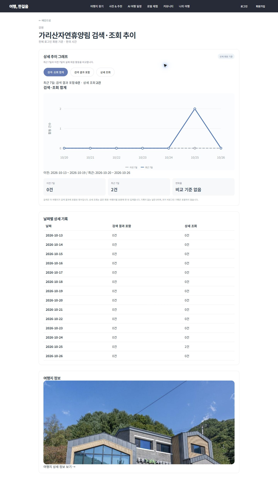](screenshots/07-trend-full.jpg)

## 8. 커뮤니티

**진입:** 상단 ‘커뮤니티’. **목적:** 여행 리뷰, 질문과 소통 글을 탐색하고 공유합니다.

상단 검색창에서 여행지·제목·내용을 검색하고 왼쪽에서 글 종류와 지역을 좁힙니다. ‘이번 달 가장 많이 리뷰된 여행지’는 리뷰가 연결된 장소를 순위와 사진으로 보여주며 ‘리뷰 보기’는 해당 여행지에 연결된 리뷰 탐색으로 이어집니다. 글 목록에서는 제목·요약·지역·반응·작성자 등으로 내용을 비교하고 상세 글을 엽니다.

로그인 후 ‘글쓰기’에서 종류에 맞게 게시할 수 있습니다. 여행 리뷰는 여행지 태그와 선택 별점으로 장소에 연결합니다. 질문·소통은 정보 교환과 대화 용도입니다. 아래 사진은 순위 영역부터 필터, 게시글 목록과 페이지 이동까지 담았습니다.

현재 예시 글은 화면과 동작 확인을 위한 개발 데이터가 포함돼 있습니다. 예시 제목·본문·사진 출처 표시는 그대로 유지했으며, 글 수를 실제 이용자 수나 만족도 지표로 해석하지 않습니다.

[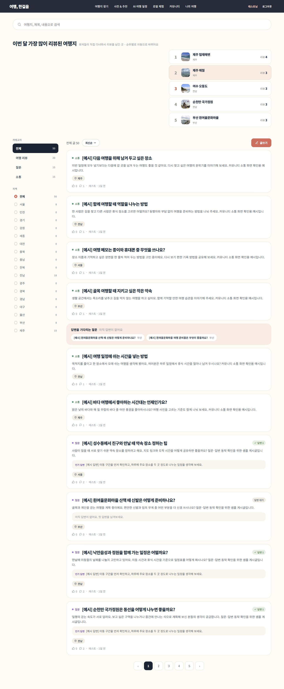](screenshots/08-community-full.jpg)

## 9. 로컬 체험

**진입:** 상단 ‘로컬 체험’. **목적:** 지역 주민이 운영하는 산책·음식·문화교류 등 프로그램을 탐색합니다.

왼쪽 필터에서 지역, 체험 진행 언어, 관심 분야와 모집 중 여부를 선택하고 조건으로 검색합니다. 화면 언어 선택은 메뉴와 안내의 표시 언어이고, 체험 진행 언어는 현장에서 사용하는 언어입니다. 두 조건을 구분해 선택합니다.

카드에는 지역·이름·소개·진행 날짜·소요 시간·정원·가격이 표시됩니다. 카드를 열어 상세 설명과 회차 등을 확인합니다. 추천순·최신순 정렬과 새로고침으로 목록을 다시 확인할 수 있습니다. AI로 만든 시연 이미지는 카드 위에 ‘AI 생성 이미지’라고 표시합니다.

**캡처 읽기:** 검색 필터와 체험 카드 전체 목록을 포함했습니다. 시연 체험의 가격·신청 흐름은 실제 상용 결제 완료를 의미하지 않습니다.

[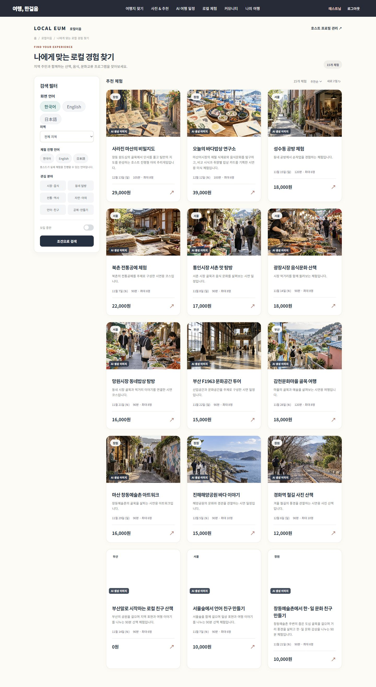](screenshots/09-local-experiences-full.jpg)

## 10. 호스트 운영센터

**진입:** 로컬 체험의 호스트 프로필 관리 경로. **이용 조건:** 공통 로그인 계정으로 본인 호스트 정보에 접근합니다.

호스트 프로필에는 여행자에게 공개할 이름과 소개를 입력합니다. 이름은 1~80자, 소개는 최대 2,000자이며 변경한 후 저장하면 해당 호스트와 연결된 공개 체험의 공통 프로필에 반영됩니다. 체험별 설명과 호스트 공통 소개는 따로 관리합니다.

왼쪽 메뉴는 운영현황, 프로그램·회차 관리, 신청자 관리, AI 기획·진단과 호스트 프로필로 나뉩니다. 일반 회원이 본인 프로필을 만드는 것과 승인된 호스트가 체험을 공개·운영하는 권한은 구분합니다. 화면 상단의 승인 상태와 안내를 먼저 확인해야 합니다.

**캡처 읽기:** 테스트 계정의 승인 대기 상태입니다. 프로필은 수정할 수 있지만 체험 공개·운영은 승인 후 이용한다는 안내가 표시됩니다. 신청자 연락처 등 개인정보 화면은 촬영하지 않았습니다.

[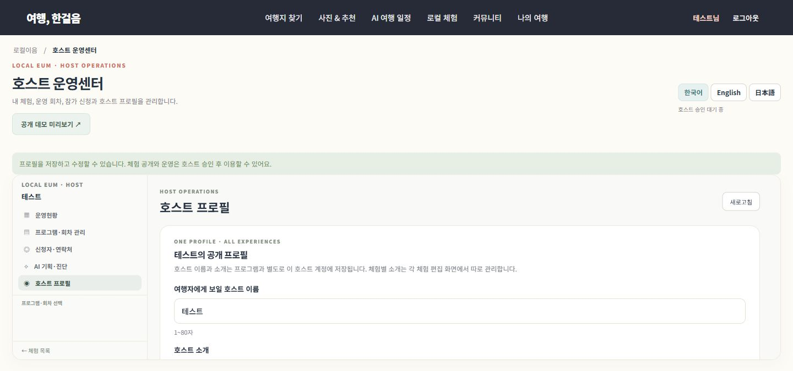](screenshots/10-host-profile-full.jpg)

## 11. 지난 여행 전체 상세

**진입:** 나의 여행 하단 ‘지난 여행 일정’ 카드의 ‘전체 일정 상세 보기’.

이 화면은 개별 장소 한 곳이 아니라 **저장된 여행 한 개 전체**를 확인하도록 구성했습니다. 일정 제목·기간·장소 수와 요약을 먼저 보고, DAY 1부터 날짜별 방문 장소를 순서대로 확인합니다. 각 장소 행에는 시간·종류·사진·추천 이유·주소가 표시되며 저장된 정보가 없는 항목은 생략합니다.

상세 팝업은 내부 스크롤로 다음 날짜와 마지막 장소까지 내려봅니다. 각 장소의 ‘장소 정보 보기’는 관광정보 상세로, ‘리뷰 쓰기’는 해당 장소가 선택된 글쓰기 화면으로 연결됩니다. 전체 일정 확인과 장소별 리뷰 작성을 같은 흐름 안에서 처리합니다.

**자료 구분:** 이번에는 지난 일정 목록을 포함한 나의 여행 전체 화면을 새로 촬영했습니다. 상세 팝업은 재촬영 중 열림을 확인하지 못해 기존 사진을 참고 자료로만 유지했습니다. 기존 팝업 사진은 표시 구간의 캡처이며 전체 여행이 한 장에 담긴 사진으로 설명하지 않습니다.

[지난 일정 목록이 포함된 전체 화면](screenshots/05-mytrip-full.jpg)

기존 지난 일정 상세 팝업 참고 이미지

[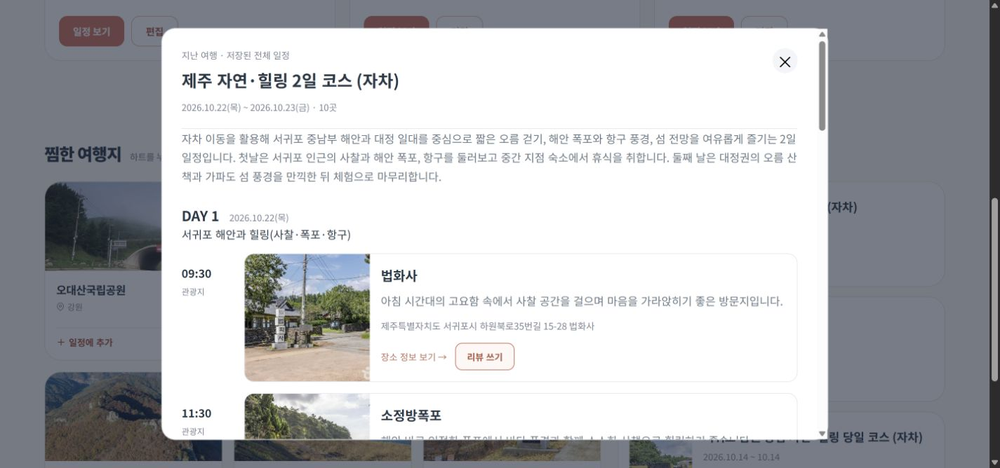](screenshots/11-past-itinerary.jpg)

## 12. 장소별 리뷰

**진입:** 지난 일정 상세의 장소별 ‘리뷰 쓰기’ 또는 커뮤니티 ‘글쓰기’. **이용 조건:** 로그인 필요.

일정에서 진입하면 선택한 장소가 여행지 태그로 연결됩니다. 캡처에서는 법화사 이름과 주소가 자동으로 채워지고 지역이 제주로 분류된 상태를 확인할 수 있습니다. 다른 장소도 검색해 태그할 수 있고 불필요한 태그는 삭제합니다.

| 입력 항목 | 작성 기준 |
| --- | --- |
| 글 종류 | 여행 리뷰·질문·소통 선택 |
| 제목 | 최대 100자 |
| 여행지 태그 | 여행 리뷰는 1곳 이상, 최대 10곳 |
| 장소별 별점 | 선택 입력, 1~5점, 같은 별 재선택 시 취소 |
| 내용 | 최대 1,200자 |
| 사진 | 새 업로드는 준비 중으로 표시 |

제목·태그·본문을 확인한 뒤 ‘등록’을 누르면 커뮤니티에 글을 게시합니다. ‘취소’는 작성 화면에서 나갑니다. 아래 사진에는 글 종류부터 태그·별점·본문·사진 준비 안내·등록 버튼까지 모두 포함했습니다. 촬영 중 새 리뷰는 게시하지 않았습니다.

[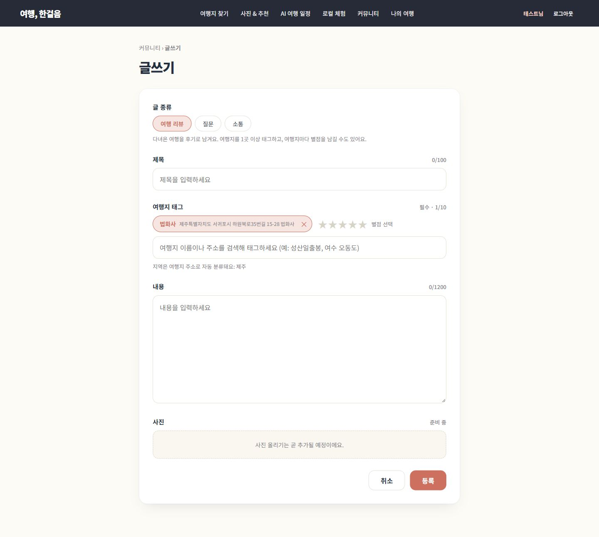](screenshots/12-place-review-full.jpg)

## 촬영 범위와 이미지 출처

- 추천 메인·AI 결과·활동 추이는 공개 서비스에서, 회원 전용 화면과 커뮤니티·로컬 체험은 개발 서비스에서 촬영했습니다. 배포 환경과 개발 환경의 동작은 각각 확인해야 합니다.
- 관광지 목록 조회 오류와 지난 일정 팝업 재촬영 미완료는 위 해당 절에 명시했습니다. 이 가이드는 모든 기능의 운영 검증이 완료됐다는 테스트 성적서가 아닙니다.
- 촬영을 위해 기존 회원 일정을 추가·삭제하거나 리뷰를 게시하지 않았습니다. 로그인 정보와 비밀키는 이미지에 포함하지 않았습니다.
- 관광 사진은 한국관광공사 TourAPI 등 화면에 표시된 출처를 따릅니다. 커뮤니티 예시의 사진 출처와 지도의 OpenStreetMap 저작권 표시는 보존했습니다. 로컬 체험의 AI 이미지는 실제 현장 사진으로 설명하지 않습니다.
