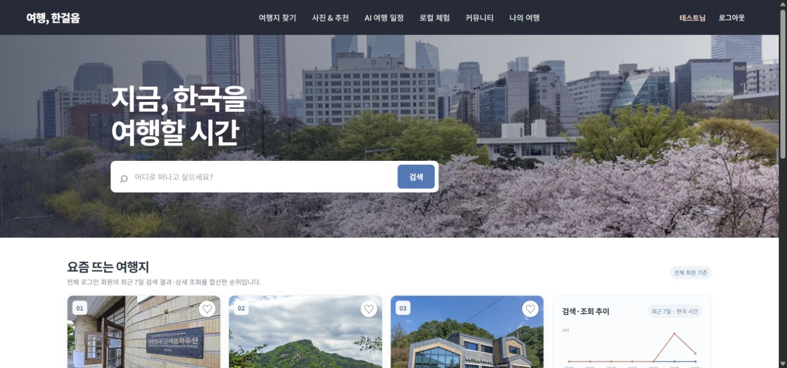
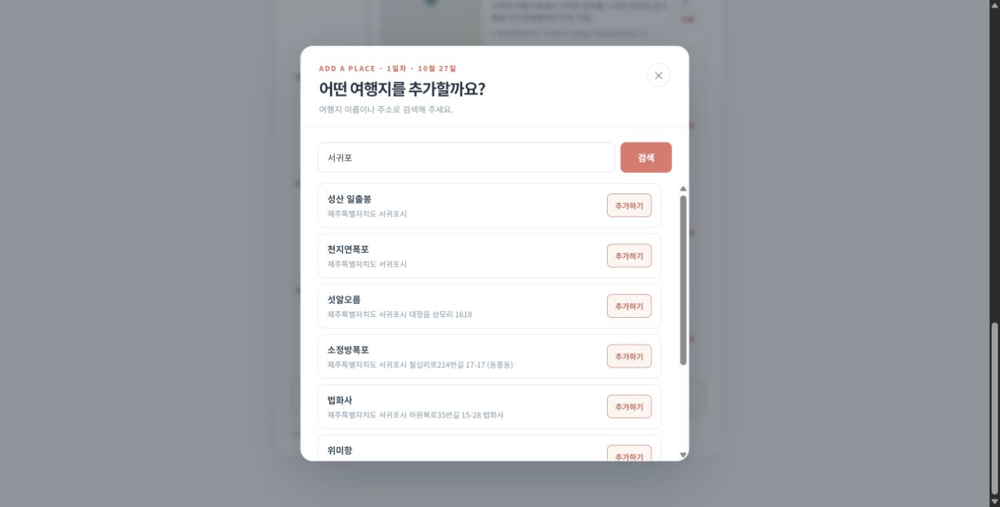
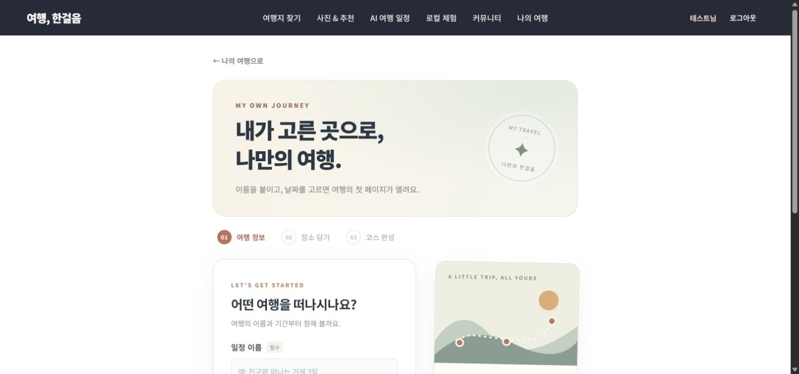
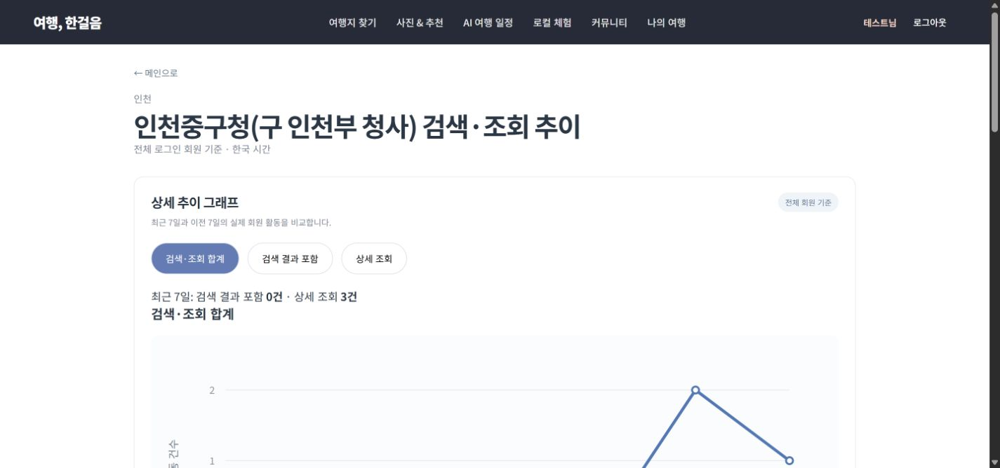
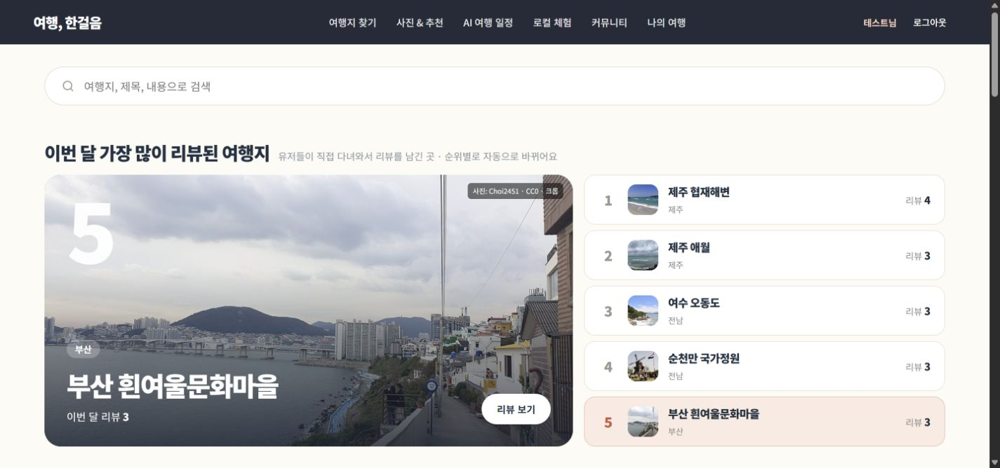
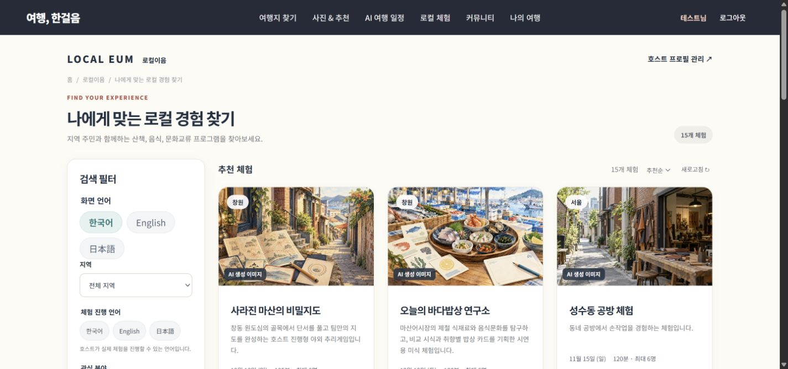
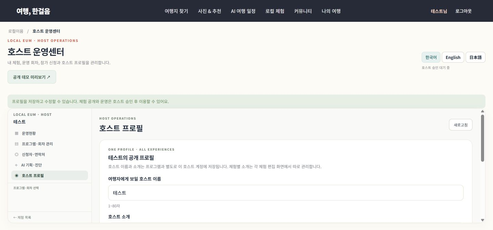
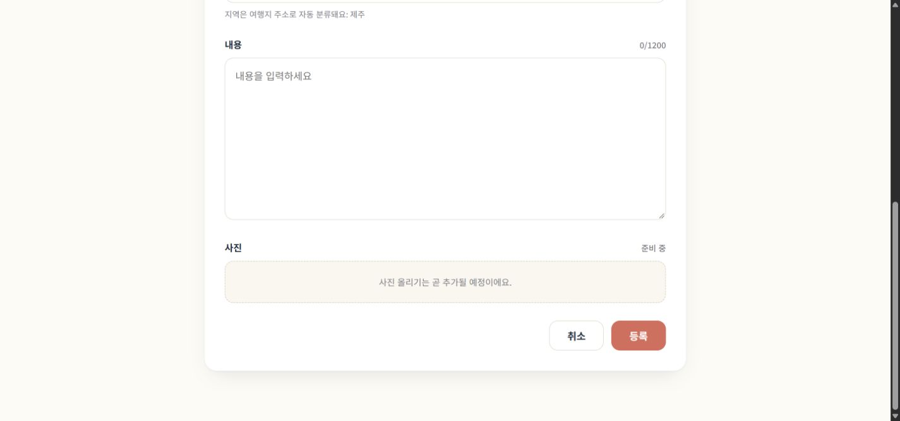

# 실제 기능 화면 가이드

2026-10-26 실행 중인 개발 서비스에서 직접 촬영했다. 테스트 계정과 개발·시연 데이터를 사용했으며 실제 외부 사용자 테스트와 구분한다. 새 AI 일정 생성과 검색을 확인했고, 촬영을 위해 기존 회원 일정을 저장·삭제하지 않았다.

## 추천 메인

전체 로그인 회원의 검색·조회 순위와 최근 브라우저 검색 기반 추천을 구분한다.

## 관광지 목록

DB에서 24개씩 읽고 지역·이름·주소로 필터링한다. 수집과 화면 조회는 분리한다.

## AI 일정 생성

실제 제주 3일 생성 결과다. 서귀포 권역, 일별 예보, 후보 ID와 위치 지도를 확인했다.

## 일정에 장소 추가

서귀포 검색 결과에서 현재 선택 일차로 추가한다. 기존 회원 일정을 변경하지 않고 검색 표시를 확인했다.

## 나의 여행

AI·직접 일정의 공통 목록과 계정별 저장 정보를 보여준다. 일정 3개·찜 6개·지난 일정 3개 단위 페이지다.

## 직접 일정 시작

AI 없이 이름·지역·날짜로 빈 계획을 만들고 날짜별 장소를 담는다.

## 회원 활동 추이

개인 기록이 아닌 전체 로그인 회원 기준이다. 이전 7일과 최근 7일의 실제 활동을 비교한다.

## 커뮤니티

현재 50개 개발 샘플 글과 장소별 사진을 표시한다. 외부 사용자 수나 실제 만족도 지표가 아니다.

## 로컬 체험

15개 시연 체험, 진행 언어·화면 언어·지역 필터를 제공한다. AI 이미지는 생성 이미지로 표시한다.

## 호스트 운영센터

일반 회원이 본인 호스트 프로필에 접근한다. 현재 테스트 계정은 승인 대기로 공개·운영 권한을 구분한다.

## 지난 여행 전체 상세

여행 단위로 모든 날짜 코스를 표시하고 각 장소의 리뷰 작성 링크를 제공한다.

## 장소별 리뷰

지난 일정에서 선택한 법화사가 태그에 자동 연결된다. 제목·본문·별점을 작성한다. 새 사진 업로드는 준비 중이다.

## 이미지 출처와 해석

관광 사진은 화면에서 제공한 한국관광공사 TourAPI 등 각 이미지의 출처를 따른다. 커뮤니티 샘플의 개별 출처 표시는 화면에 남겼다. 로컬 체험의 AI 시연 이미지는 실제 현장 사진으로 설명하지 않는다. 지도의 저작권 표시는 캡처에 보존했다. 비밀키·환경 설정·신청자 연락처는 화면 자료에 포함하지 않았다.
