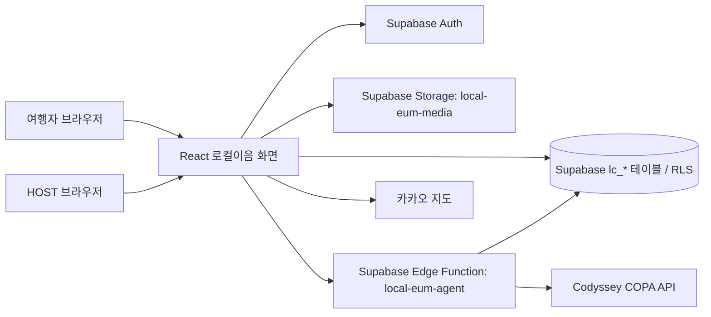

# AI-Travel-Planner의 로컬이음 영역

AI-Travel-Planner는 여행지 탐색·검색과 추천, 나의 여행, 여행 커뮤니티, 로컬 체험을 한곳에서 제공하는 팀 프로젝트입니다. 서비스 전체 화면은 여행의 여러 단계에서 필요한 정보와 기능을 연결하도록 구성되어 있습니다.

로컬이음은 이 팀 서비스 안에서 지역 주민과 여행자를 연결하는 체험 영역입니다. 여행자는 시장·골목·문화 체험을 찾고 신청할 수 있고, 호스트는 자신의 프로그램과 운영 회차를 관리합니다. 이 README는 팀 전체 저장소 중 로컬이음 담당 범위의 구현, 실행 방법, 데이터 상태를 설명합니다. 다른 팀 영역의 구현 설명이나 실행 절차는 이 문서의 범위에 포함하지 않습니다.

## 대상과 목적

### 해결하려는 문제

여행자는 지역의 시장·골목·생활문화를 주민의 관점에서 경험할 프로그램을 찾기 어렵고, 체험 소개와 진행 언어·일정·집결 정보가 흩어져 있으면 참여 여부를 판단하기 어렵습니다. 호스트는 여러 체험을 운영하면서 소개와 회차, 신청자를 각각 관리해야 하며, 외국어 여행자에게 정보를 제공하는 일도 부담이 됩니다. AI가 만든 정보가 확인된 사실처럼 보이거나 시연 결제가 실제 거래로 오해될 위험도 있습니다.

### 대상 사용자

- **여행자:** 한국 여행 중 지역 주민과 함께하는 소규모 시장·골목·문화 체험을 찾는 국내외 방문자. 로그인 사용자와 비회원 신청자를 모두 포함합니다.
- **HOST:** 승인된 호스트 계정으로 하나의 공통 호스트 프로필을 두고 여러 체험과 각 체험의 운영 회차를 관리하는 지역 운영자입니다.
- **팀원·심사위원:** 공개 운영센터 데모에서 가상 호스트의 운영 흐름을 로그인이나 실제 개인정보 없이 확인하는 검토자입니다.

### 만들려는 가치와 AI의 역할

여행자에게는 프로그램 소개, 일정, 장소, 호스트 정보를 한 흐름에서 비교하고 신청할 수 있는 접점을 제공합니다. 호스트에게는 프로그램·회차·신청자·공통 프로필을 통합 관리하는 공간을 제공하고, 검증 가능한 지역 자료와 기존 프로그램을 바탕으로 체험 아이디어와 운영 초안을 만드는 AI 보조 기능을 제공합니다. AI는 기획을 돕지만 사실 확인, 최종 판단, 저장은 호스트가 맡습니다. 번역 초안은 언어 장벽을 낮추는 데 쓰고, 실제 진행 가능 언어는 호스트가 별도로 확인합니다.

이 영역의 핵심 AI 기술은 **도구를 사용하는 Agent**와 **출처를 함께 제시하는 RAG**입니다. 평가 점수와 비용 계산은 재현 가능한 서버 로직을 사용하고, 지역 자료로 근거를 찾지 못하면 근거 부족으로 표시합니다. 실제 결제, 제휴·영업 보장, 호스트의 안전·법률 판단을 AI가 대신하지 않습니다.

### 완료 상태

로컬 개발 화면, Supabase 개발 DB 연동, Codyssey 기반 Agent, 참가 신청 시연 흐름, 호스트 운영센터, 영어·일본어 번역 초안까지 구현했습니다. DB 적용 내용과 현재 검수 상태는 아래에 기록했습니다. 외부 서비스 배포와 최소 5명 실사용자 테스트 및 피드백 반영은 별도 수행·증빙이 필요한 과제 항목이며, 완료된 것으로 표시하지 않습니다.

## 주요 화면

| 화면 | 경로 | 주요 기능 |
| --- | --- | --- |
| 체험 목록 | `/local-eum` | 체험 카드, 지역·관심 분야·모집 상태 필터, 표시 언어 선택 |
| 체험 상세 | `/local-eum/experiences/:experienceId` | 소개, 일정, 장소·지도, 호스트, 모집 회차, 참가 신청. 시연 상세는 `?demo=language-friends` 필요 |
| 호스트 운영센터 | `/local-eum/host/profile` | 본인 프로그램·회차, 신청자 연락처, 호스트 프로필, AI 기획·진단 통합 관리 |
| 공개 운영센터 데모 | `/local-eum/host/profile?demo=1` | 로그인 없이 가상 호스트·프로그램·신청 데이터를 읽기 전용으로 확인 |
| 회차 편집 | `/local-eum/host/sessions/:sessionId/edit` | 운영 날짜·시간·장소·모집 조건 등 회차별 정보 편집 |

### 여행자 기능

- Supabase에 등록된 체험을 카드와 상세 화면으로 조회합니다.
- 지역, 관심 분야, 모집 중 여부와 호스트가 확인한 체험 진행 언어를 필터링합니다. 화면 표시 언어와 실제 진행 언어는 별도 정보입니다.
- 체험별 일정, 참가비, 정원, 장소·집결 정보와 카카오 지도를 보여줍니다. 확인되지 않은 좌표를 만들어 표시하지 않습니다.
- 로그인 사용자는 계정과 연결해 신청할 수 있고, 비회원은 계정 없이 신청할 수 있습니다.
- 접수 후 접수번호와 시연용 결제 안내를 보여줍니다. 현재 가상계좌 표시는 실제 은행 계좌가 아니며 입금 확인·실제 결제는 제공하지 않습니다. 카드 결제는 비활성 상태입니다.
- 일반 공개 목록은 Supabase에서 읽은 `PUBLISHED` 체험만 표시합니다. 서울·부산·창원의 정적 언어·친구 fixture는 URL에 `?demo=language-friends`가 있을 때만 시연 목록과 상세에서 사용하며, 신청·예약·결제할 수 없습니다. 언어·친구 관심 분야만 고른 경우 fixture를 공개 데이터처럼 섞지 않습니다.

### 호스트 기능

- 로그인한 HOST는 자신의 호스트 프로필과 소유 체험·회차를 관리합니다. 호스트 한 명이 여러 프로그램을 운영하며 호스트 소개는 프로그램마다 중복 작성하지 않습니다.
- 운영센터는 프로그램·회차를 선택해 상세 소개, 일정, 회비, 여행자 미리보기와 신청자 정보를 한 화면에서 다룹니다.
- 기존 신청 데이터에서 선택 회차의 신청자 연락처를 조회하고 복사하거나 전화·메일 앱으로 연결할 수 있습니다. 연락처를 AI 요청에 보내지 않습니다.
- 체험 및 호스트 소개의 영어·일본어 번역 초안을 편집하고 검수 상태를 관리합니다.
- 공개 데모는 가상 데이터와 읽기 전용 기능만 사용합니다. 실제 연락처, 실제 HOST 데이터, AI 호출, 저장 동작을 노출하지 않습니다.

### 언어 번역과 진행 언어

로컬이음은 `ko`, `en`, `ja` 표시 언어를 지원합니다. 영어·일본어 콘텐츠는 번역 JSON으로 한국어 원문과 분리되어 있고 다음 데이터에 저장됩니다.

| 대상 | 번역 범위 | 현재 DB 상태 |
| --- | --- | --- |
| 호스트 (`lc_hosts.translations`) | 호스트 소개 | 호스트 2명 모두 영어·일본어 초안 |
| 체험 (`lc_experiences.translations`) | 제목, 요약, 상세 소개 | 체험 15개 모두 영어·일본어 초안 |
| 진행 단계 (`lc_experience_steps.translations`) | 단계 제목과 설명 | 기존 50개와 언어·친구 체험 18개 단계에 영어·일본어 초안 적용. 총 68개 단계의 검수 상태는 `DRAFT` |

번역 초안은 `review_status: DRAFT`로 시작합니다. 호스트가 각 언어 문구를 확인하고 검수 상태를 바꾸며, 번역 내용을 다시 수정하면 해당 언어는 다시 초안으로 표시됩니다. 일부 필드만 번역된 경우 누락된 문구는 한국어 원문으로 보완합니다. 화면 표시 언어를 영어 또는 일본어로 바꾸는 것만으로 실제 체험 진행 언어가 바뀌지는 않습니다.

체험의 `available_languages`는 호스트가 실제로 해당 언어로 안내할 수 있다고 확인할 때만 설정합니다. 2026-10-20 읽기 전용 조회에서 #113·#114는 빈 배열이었고 #115에는 `ko`, `en`, `ja`가 들어 있었습니다. 2026-10-18 적용 기록의 세 체험 빈 배열과 #115의 현재 값이 달라, 해당 언어가 HOST 확인을 거친 값인지는 별도 확인이 필요합니다. 공개 목록은 DRAFT 체험을 제외하므로 현재 이 차이가 공개 진행 언어 필터 결과를 만들지는 않습니다. 번역 검수와 진행 가능 언어 설정은 각각 별도 절차입니다.

## AI 체험 기획·진단

호스트 운영센터의 **AI 기획·진단** 또는 회차 편집 화면에서 현재 체험을 분석하거나 새 아이디어를 제안받습니다. Supabase Edge Function `local-eum-agent`가 로그인 JWT, HOST 역할, 승인된 호스트 프로필과 체험 소유권을 확인한 뒤 Codyssey COPA의 OpenAI 호환 Chat Completions API를 호출합니다. 기본 모델은 `gpt-5.4-mini`이며 요청 언어는 한국어·영어·일본어 중 선택합니다.

현재 체험 분석은 참가 이유, 호스트 고유 가치, 적극 참여, 기억에 남는 결과, 운영 안전성의 5개 기준으로 잠정 평가합니다. 보고서에는 강점·약점·위험, 출처, 2~4개의 차별화 대안이 포함됩니다. 호스트가 대안 하나를 고르면 Agent가 일정표, 호스트 역할, 참가자 결과물, 준비물, 포함·불포함 사항, 집결·가격 확인 항목, 안전·법적 점검, 준비 과제를 포함한 운영 초안을 생성합니다.

Agent의 네 가지 도구는 기존 공개 체험 검색, 지역 지식 검색(RAG), 5개 기준 가치 평가, 운영비 계산입니다. 점수와 매출 계산은 서버에서 실행합니다. 회비는 DB에 저장된 시연 금액을 사용하고 재료비·고정비는 입력하더라도 미검증 가정으로 표시합니다. 검색 자료는 출처 URL과 확인일을 포함하지만, RAG 자료만으로 제휴·영업·원가·위생·시설 이용 조건을 확정할 수는 없습니다. AI 결과는 제안이며 HOST 검토가 필요합니다.

모델이 만든 제안은 즉시 DB에 저장되지 않습니다. 호스트가 결과를 검토해 편집란에 복사한 다음 일반 저장 흐름을 거쳐야 반영됩니다. 현재 어댑터는 제공 API가 네이티브 도구 호출을 지원하지 않는 경우에도 일반 채팅 응답으로 도구 입력 JSON을 받아 Edge Function의 허용 목록·입력 검증을 거쳐 실행합니다. 모델이 임의 SQL이나 브라우저 도구를 실행하지 않습니다.

보안·제한 사항: HOST 소유권은 함수 안에서 다시 확인하고 관련 체험은 RLS가 적용된 사용자 JWT로 읽습니다. 이메일과 휴대전화 형식은 모델 입력에서 제거하며, 로그에는 도구명·소요시간·결과 수·오류 코드만 남깁니다. 요청당 최대 5회 모델 호출, 입력 길이·도구 실행 제한, Edge 인스턴스별 HOST 계정당 시간당 12회 제한이 적용됩니다. 인스턴스별 호출 제한은 전역 사용량 제한이 아니므로 공개 운영에는 지속 저장되는 전역 쿼터나 제공자 예산 경보가 추가로 필요합니다.

API 키는 Supabase Edge Function Secret의 `CODYSSEY_API_KEY`로 관리합니다. 브라우저 환경변수, 데이터베이스, Git 파일에 키를 넣지 마세요. 모델과 CORS origin 설정, 함수 배포 및 진단 방법은 [AI Agent 실행·배포 안내](ai-agent-runbook.md)를 참고하세요.

## 구성과 데이터 흐름



로컬이음의 사용자·호스트·체험 데이터는 Supabase를 사용합니다. 팀 프로젝트의 다른 영역에서 사용하는 Oracle 연결을 로컬이음 데이터 저장에 사용하지 않습니다. 브라우저는 Supabase publishable key와 RLS를 사용하고, 서비스 역할 키는 사용하지 않습니다.

주요 테이블은 `lc_user_roles`, `lc_hosts`, `lc_program_templates`, `lc_experiences`, `lc_sessions`, `lc_experience_steps`, `lc_places`, `lc_applications`, `lc_application_payments`입니다. 하나의 `lc_hosts` 행이 여러 체험을 소유할 수 있습니다. 공개 조회와 호스트 본인 데이터 쓰기는 RLS와 서버 측 소유권 확인에 따릅니다.

## 팀 공동 실행 환경

로컬이음 코드는 공통 React 앱의 `/local-eum` 경로에서 실행됩니다. `src/App.jsx`가 체험 목록·상세·호스트 경로를 등록하고, 공통 `src/components/header.jsx`의 **로컬 체험** 메뉴가 목록으로 연결합니다. 팀원은 본인 작업 브랜치를 유지한 채 아래 순서로 병합된 `main`을 반영합니다.

```powershell
git status --short --branch
# 미커밋 변경이 있으면 본인 브랜치에 커밋하거나 이름을 붙여 stash한 뒤 계속합니다.
git fetch origin
git switch <내-작업-브랜치>
git merge origin/main
npm install
```

충돌이 나면 본인 작업과 `main`의 변경을 파일별로 확인해 해결한 뒤 빌드합니다. `reset --hard`, `clean`, 강제 checkout, 강제 push로 작업을 덮어쓰지 않습니다. `main`에 PR이 병합되어도 각 팀원의 개인 브랜치와 PC는 자동 갱신되지 않으므로 각자 동기화해야 합니다.

저장소 루트 `.env.example`을 참고해 `.env.local`에 `VITE_SUPABASE_URL`과 `VITE_SUPABASE_PUBLISHABLE_KEY`를 설정합니다. 현재 개발 대상은 `local-eum-dev` (`rhkaxmqdkztpbljkunxb`)입니다. URL과 publishable key는 Supabase Dashboard의 **Connect** 또는 **Project Settings → API Keys**에서 확인합니다. 브라우저에는 publishable key만 사용하고 `service_role` 또는 `sb_secret_` 키는 넣지 않습니다. 로컬 `.env.local`은 Git에 커밋하지 않습니다.

팀이 사용하는 Vercel 프로젝트에도 같은 두 값을 **프로젝트 환경변수**로 등록하고 새 배포를 해야 합니다. 변수는 빌드 시점에 프런트엔드 번들에 반영됩니다. API 키 값을 저장소나 사례 문서에 적지 말고, 각 팀원에게는 승인된 Supabase 개발 프로젝트의 공개 설정만 안전한 팀 공유 채널로 전달합니다. HOST 편집은 각자 권한이 있는 계정으로 확인하고, 공개 데모는 로그인 없이 읽기 전용으로 확인합니다.

## 개발 환경 실행

필요 항목: 저장소의 Node.js 호환 버전과 npm. 개발 환경 변수는 저장소 루트 `.env.example`을 참고해 `.env.local`에 설정합니다.

```powershell
npm install
if (-not (Test-Path .env.local)) { Copy-Item .env.example .env.local }
npm run dev
```

브라우저에서 `http://127.0.0.1:5173/local-eum`을 열어 Supabase 공개 체험 목록을 확인합니다. 공개 호스트 운영센터 데모는 `http://127.0.0.1:5173/local-eum/host/profile?demo=1`입니다. Header의 **로컬 체험** 메뉴에서 `/local-eum`으로 이동하는 것도 확인합니다. 두 주소 모두 각자의 컴퓨터에서 실행하는 로컬 개발 주소이며 다른 사람에게 공유할 외부 주소가 아닙니다. API 서버를 사용하는 별도 여행 기능은 `npm run server`가 필요하지만, 로컬이음의 공개 목록·상세 조회는 Supabase를 직접 사용합니다.

로컬이음에 필요한 환경변수:

| 변수 | 용도 |
| --- | --- |
| `VITE_SUPABASE_URL` | 개발용 Supabase 프로젝트 URL |
| `VITE_SUPABASE_PUBLISHABLE_KEY` | 브라우저 Supabase 클라이언트용 공개 키 |
| `VITE_KAKAO_MAP_JAVASCRIPT_KEY` | 선택 항목. 카카오 지도 표시용 JavaScript 키 |

Codyssey 키는 `.env.local`에 넣지 않고 Supabase Dashboard → Edge Functions → Secrets에 등록합니다. `.env.local`을 Git에 추가하거나 키를 이 문서에 적지 마세요.

## Supabase 상태와 변경 기록

현재 개발 대상은 `local-eum-dev` 프로젝트입니다. 프로젝트 ID: `rhkaxmqdkztpbljkunxb`. 다른 프로젝트에 SQL을 실행하기 전에 Dashboard의 프로젝트 이름과 ID를 확인하세요.

2026-10-20 읽기 전용 원격 조회에서 호스트 2명, 체험 15개, 일정 단계 68개, 운영 회차 19개를 확인했습니다. 체험 소유 관계는 호스트 500번이 13개, 호스트 501번이 2개입니다. 새 언어·친구 #113·#114·#115와 회차 #17·#18·#19는 모두 `DRAFT`입니다. 공개 목록에서는 제외되며 신청 가능 상태가 아닙니다.

| 체험 | 회차 | 상태 | 1인 표시 회비 | DB `available_languages` |
| --- | ---: | --- | ---: | --- |
| 서울 #113 | #17 | DRAFT / DRAFT | 10,000원 | 빈 배열 |
| 부산 #114 | #18 | DRAFT / DRAFT | 0원 | 빈 배열 |
| 창원 #115 | #19 | DRAFT / DRAFT | 10,000원 | `ko`, `en`, `ja` (HOST 확인 여부 미검증) |

시연 fixture의 회비도 DB 값과 맞췄습니다. SQL 적재 기록에는 세 체험의 진행 언어가 모두 빈 배열이라고 적혀 있지만, 현재 원격 #115에는 세 언어가 등록되어 있습니다. 이 문서화 불일치는 임의로 DB에서 지우거나 승인된 값으로 간주하지 않았습니다.

- 기존 신청 및 시연 결제 테이블/RPC 적용본: [`migrations/20261017_experience_applications.applied.sql`](migrations/20261017_experience_applications.applied.sql)
- 호스트 ID 보조 함수 적용본: [`migrations/20261017_host_profile_own_id.applied.sql`](migrations/20261017_host_profile_own_id.applied.sql)
- 영어·일본어 번역 스키마 적용본: [`migrations/20261017_local_eum_languages.applied.sql`](migrations/20261017_local_eum_languages.applied.sql)
- 호스트 2명·체험 12개·일정 50개의 번역 시드 적용본: [`migrations/20261018_local_eum_translation_seed.applied.sql`](migrations/20261018_local_eum_translation_seed.applied.sql)
- 언어·친구 3개 도시의 DB 적재 및 이미지 후속 적용: [`migrations/20261018_local_eum_language_friends_three_city.applied.md`](migrations/20261018_local_eum_language_friends_three_city.applied.md)
- 언어·친구 신규 일정 18개 번역 적용본: [`migrations/20261020_language_friends_itinerary_translations.applied.sql`](migrations/20261020_language_friends_itinerary_translations.applied.sql)
- 회차 생성·취소 권한 및 체험 취소 RPC 적용본: [`migrations/20261017_host_operations_lifecycle.applied.sql`](migrations/20261017_host_operations_lifecycle.applied.sql)
- 두 SQL의 원격 적용·검증 기록: [`migrations/20261020_language_friends_and_host_lifecycle.applied.md`](migrations/20261020_language_friends_and_host_lifecycle.applied.md)
- HOST 프로필의 번역 열 조회 권한 보완: [`migrations/20261018_host_profile_translation_read.applied.md`](migrations/20261018_host_profile_translation_read.applied.md)

영어·일본어 번역은 초안(`DRAFT`)입니다. 신규 일정 18개 번역은 2026-10-20 원격 DB에 적용했고, 체험별 6개씩 `DRAFT` 상태를 조회로 확인했습니다. 호스트가 직접 검수한 뒤에만 검수 완료로 바꿔야 합니다. 번역 데이터가 있다는 이유만으로 체험 진행 언어를 활성화하지 않습니다. 원격 #115의 `available_languages`는 기존 적용 기록과 달라 확인이 필요합니다. 자세한 번역 스키마 적용 상태는 [언어 번역 적용 기록](local-eum-language-rollout.md)을 확인하세요.

참가 신청은 `lc_submit_experience_application` RPC에서 모집 상태·마감 시각·정원·개인정보 동의 등을 검사하고 신청과 결제 시연 행을 함께 만듭니다. `PENDING` 신청은 24시간 동안 정원 계산에 포함되고 이후에는 만료됩니다. 비회원은 공개 테이블에서 신청 내용을 조회할 수 없으며, HOST는 소유 체험의 신청만 조회합니다. 결제 행은 `DEMO_ONLY`이며, 화면의 `DEMO-` 번호는 실제 은행 가상계좌가 아닙니다. 카드 결제, 입금 확인, 예약 확정, 환불은 구현되지 않았습니다.

회차 추가·운영 취소 정책과 `lc_cancel_experience` RPC는 2026-10-20 `local-eum-dev`에 적용됐습니다. 원격 조회에서 HOST/ADMIN 범위의 DRAFT 회차 INSERT 정책, `CANCELLED` 상태 제약, 취소 RPC와 익명 실행 차단을 확인했습니다. 회차 취소는 기록을 삭제하지 않고 상태를 바꾸며, 체험 취소는 시작 전 회차를 함께 취소하고 기존 신청·결제 기록을 보존합니다. 실제 HOST/ADMIN 계정별 조작 검증과 신청자 연락·환불 절차는 별도 운영 테스트가 필요합니다. 현황은 [호스트 운영센터 안내](host-operations-guide.md)와 [회차 편집 안내](session-editor-guide.md)를 참고하세요.

체험 대표 이미지는 Supabase Storage의 `local-eum-media` 버킷을 참조합니다. 경로 해석과 카드의 시연 이미지 표시는 `experienceImageSource.js` 및 `ExperienceImage.jsx`에 있으며, 생성형 이미지가 실제 장소 사진처럼 오인되지 않도록 시연 표시를 사용합니다. 카카오 지도는 선택적 `VITE_KAKAO_MAP_JAVASCRIPT_KEY`가 설정된 경우 사용하고, 좌표가 검증되지 않은 장소에 임의 마커를 만들지 않습니다.

## 확인 명령

```powershell
npm run build
npm run lint
node --test src/pages/local-eum/*.test.js
```

AI Edge Function은 Deno 환경에서 별도로 확인합니다.

```sh
node --test supabase/functions/local-eum-agent/*.test.mjs
deno check supabase/functions/local-eum-agent/index.ts
deno lint supabase/functions/local-eum-agent
```

테스트는 로컬 로직과 모의 모델 호출을 확인합니다. 실제 모델 품질, 다른 HOST 계정 간 권한 분리, 공개 배포 상태를 대신 증명하지 않습니다.

## 데모 및 운영 시 주의

- `/local-eum/host/profile?demo=1`은 가상 호스트·프로그램·신청자 데이터만 표시하는 공개 읽기 전용 운영센터 데모입니다. `/local-eum?interest=LANGUAGE_FRIENDS&demo=language-friends`는 세 도시의 정적 시연 fixture를 명시적으로 여는 체험 목록입니다. 일반 공개 목록은 Supabase PUBLISHED 행을 사용하고 DRAFT 체험을 표시하지 않습니다. localhost 주소는 실행 중인 해당 PC에서만 열립니다.
- 시연 금액과 접수 상태는 실제 결제·예약 확정이 아닙니다. 실제 카드 결제, 은행 가상계좌 발급 및 입금 대조 기능은 제공하지 않습니다.
- 영어·일본어 번역은 사람이 검수해야 하며 체험 진행 언어 설정과 분리되어 있습니다.
- API 키와 신청자 개인정보를 로그, URL, 공개 데모, 커밋에 넣지 않습니다.
- 외부 공개와 실사용자 테스트는 별도 배포 및 검수 절차가 필요합니다. 현재 로컬 기능 검증 결과를 공개 배포 완료나 5명 이상 실사용자 테스트 완료로 표현하지 않습니다.

## 로컬이음 상세 문서

- [호스트 운영센터 사용·권한 안내](host-operations-guide.md)
- [AI Agent 실행·배포 및 테스트 안내](ai-agent-runbook.md)
- [영어·일본어 번역 데이터 적용 기록](local-eum-language-rollout.md)
- [Supabase 연결 안내](supabase-setup-guide.md)
- [회차 편집 안내](session-editor-guide.md)
- [체험 상세·장소·지도 설계](experience-detail-and-map-design.md)
- [Codyssey AI Agent 설계](../../docs/superpowers/specs/2026-10-17-local-eum-ai-agent-design.md)
- [호스트 운영센터 설계](../../docs/superpowers/specs/2026-10-17-local-eum-host-operations-and-session-lifecycle-design.md)
- [신청·시연 결제 설계](../../docs/superpowers/specs/2026-10-17-local-eum-applications-and-demo-payment-design.md)
- [다국어 지원 설계](../../docs/superpowers/specs/2026-10-17-local-eum-language-support-design.md)
