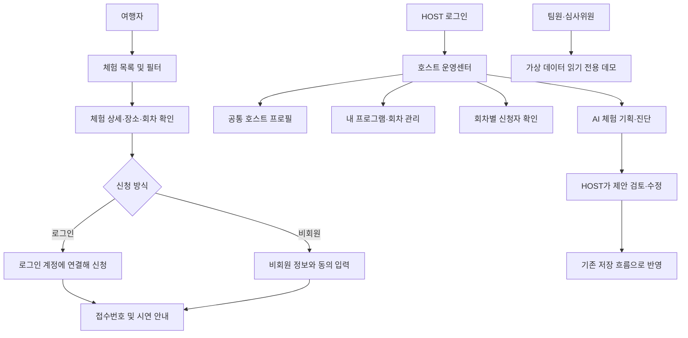
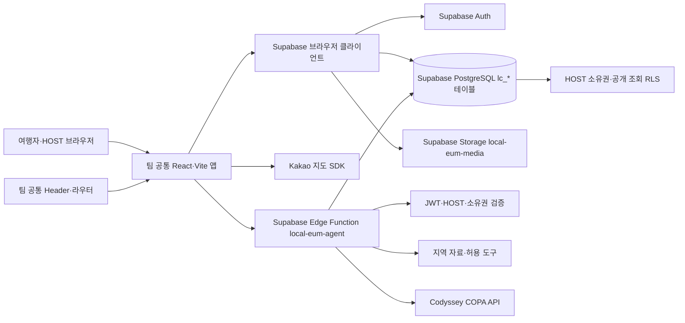

# 로컬이음 (LOCAL EUM)

로컬이음은 국내외 여행자가 지역 주민인 HOST와 만나 시장, 골목, 생활문화와 예술을 직접 경험하도록 연결하는 로컬 체험 플랫폼입니다. 여행자가 검색 결과와 관광 명소를 소비하는 데서 그치지 않고, 지역의 사람과 이야기 속에서 새로운 동네를 발견할 수 있도록 돕습니다.

로컬이음은 「여행, 한걸음」 팀 프로젝트의 한 영역입니다. 팀 공통 React·Vite 애플리케이션과 Header·라우터를 사용하며, 여행지 검색·추천·여행 일정·커뮤니티 등 팀의 다른 영역을 대체하지 않습니다. 로컬이음의 인증, 체험 운영 데이터, 신청과 AI 기능은 Supabase 기반으로 개발합니다.

## 대상과 목적

여행자는 지역 생활과 문화를 주민의 시선으로 경험할 프로그램을 찾기 어렵고, 소개·일정·집결 위치·언어 정보가 여러 곳에 흩어져 있으면 참여 여부를 판단하기 어렵습니다. 지역 HOST도 여러 프로그램을 운영할 때 공통 소개, 프로그램별 설명과 회차, 신청자를 반복해서 관리해야 합니다. 로컬이음은 여행자에게 체험 탐색부터 신청까지 이어지는 정보를 제공하고, HOST에게 여러 프로그램과 신청을 한 화면에서 관리하는 공간을 제공합니다.

주요 사용자는 다음과 같습니다.

- **여행자:** 체험과 날짜를 살펴보고, 로그인 계정 또는 비회원으로 참가를 신청합니다.
- **HOST:** 승인된 HOST 계정으로 로그인해 자신의 공통 프로필, 소유 프로그램, 운영 회차와 신청자를 관리합니다. HOST 한 명이 여러 프로그램을 운영하며, 호스트 프로필을 프로그램마다 따로 만들지 않습니다.
- **팀원·심사위원:** 로그인 없는 공개 운영센터 데모에서 가상 HOST와 샘플 신청 자료로 운영 흐름을 확인합니다.
- **ADMIN:** 호스트 승인과 전체 운영 감독은 서비스 권한 설계에 포함되지만, 현재 저장소에는 ADMIN 전용 운영 대시보드 화면이 확인되지 않았습니다. 완료된 사용자 기능으로 간주하지 않습니다.

일반 관광정보가 장소의 위치와 소개를 전달하는 데 초점을 둔다면, 로컬이음은 HOST가 진행하는 소규모 프로그램, 회차, 참가자 안내를 함께 다룹니다. AI는 체험 기획을 돕는 제안 도구이며 사람의 확인을 대체하지 않습니다. 시연 신청과 금액은 실제 예약·결제가 아닙니다.

## 서비스 이용 흐름



여행자는 목록에서 체험을 고른 뒤 상세 소개·운영 일정·장소를 확인하고 신청합니다. 로그인 신청은 계정과 연결되고 비회원 신청은 별도 신청 정보를 입력합니다. 신청 결과에는 접수번호와 시연 안내가 표시됩니다. 실제 결제, 은행 가상계좌 발급, 입금 확인, 예약 확정 및 환불은 제공하지 않습니다.

HOST는 로그인 후 `/local-eum/host/profile`에서 하나의 공통 프로필과 본인 소유 프로그램을 선택해 관리합니다. 회차별 신청 정보와 연락처는 해당 HOST의 소유 범위로 조회합니다. 공개 데모는 `/local-eum/host/profile?demo=1`이며 가상 데이터만 보여주고 저장·실제 연락·AI 호출을 수행하지 않습니다.

## 주요 화면

| 화면 | 경로 | 현재 역할 |
| --- | --- | --- |
| 체험 목록 | `/local-eum` | 체험 카드와 지역·관심 분야·모집 상태·진행 가능 언어 필터, 표시 언어 전환 |
| 체험 상세 및 신청 | `/local-eum/experiences/:experienceId` | 소개, 일정, 호스트, 장소·지도, 회차, 로그인/비회원 신청 |
| HOST 운영센터 | `/local-eum/host/profile` | 공통 프로필, 본인 프로그램·회차, 회차별 신청자, AI 기획·진단 |
| 공개 운영센터 데모 | `/local-eum/host/profile?demo=1` | 로그인 없이 가상 데이터로 읽기 전용 운영 흐름 확인 |
| 회차 편집 | `/local-eum/host/sessions/:sessionId/edit` | 선택 체험의 소개·일정·회비·상세 일정·여행자 미리보기 편집 |

호스트 공개 프로필은 여행자가 체험을 살펴보며 보는 소개 정보입니다. HOST 전용 운영센터는 로그인한 호스트가 자신의 프로필과 여러 프로그램, 회차 및 신청자를 관리하는 화면입니다. 두 화면은 목적과 접근 권한이 다릅니다.

## 구현된 기능과 현재 상태

2026-10-18 기준의 로컬 코드, 대상 개발 DB, 테스트 결과를 구분해 기록합니다. 원격 DB는 `local-eum-dev` (`rhkaxmqdkztpbljkunxb`)를 읽기 전용으로 확인했습니다.

| 영역 | 코드 상태 | 원격 DB·배포 상태 | 검증 및 제한 |
| --- | --- | --- | --- |
| 체험 탐색·상세 | 목록·필터·정렬, 상세, 회차·장소 표시 구현 | 기존 데이터 조회 | 로컬 테스트 통과. 실제 진행 언어 필터는 HOST 확인 데이터가 있어야 동작 |
| 참가 신청 | 로그인/비회원 신청 폼, 접수번호와 시연 결제 안내 | 신청·결제 안내 테이블 및 `lc_submit_experience_application` RPC 존재 | 신청 1행과 결제 시연 1행 확인. 실제 결제·입금·예약 확정은 미지원 |
| HOST 운영센터 | 공통 프로필, 소유 프로그램·회차 선택, 신청자 연락처, AI 메뉴, 공개 데모 | HOST/신청 조회 RLS 적용 상태 확인 | 공개 데모는 가상 데이터·읽기 전용. ADMIN 전용 대시보드 화면은 미확인 |
| 회차 추가·취소 | 입력 폼 및 상태 변경 호출 코드 존재 | 원격 DB에 회차 INSERT 정책 및 `lc_cancel_experience` RPC 없음 | 운영 회차 추가·취소는 DB 정책/함수 적용 전까지 실제 기능으로 보장되지 않음 |
| 영어·일본어 | 화면 표시·번역 편집 및 검수 상태 구현 | 호스트 2, 체험 12, 일정 50행에 EN/JA 번역 초안 존재 | 모든 번역은 `DRAFT`. 실제 진행 가능 언어는 체험 12개 모두 미확정 |
| AI 기획·진단 | Supabase Edge Function에서 HOST 인증·소유권 검사, 허용 도구와 RAG 실행 | `local-eum-agent`는 활성 버전 10, JWT 확인 사용 | 모의 Agent 테스트 통과. 실제 응답 품질과 전 언어 검수는 별도 수행 필요 |
| 지도·이미지 | 카카오 지도 컴포넌트와 Supabase Storage 이미지 경로 처리 | 이번 검토에서 원격 Storage 전체 객체 수는 확인하지 않음 | Kakao 키와 검증된 좌표가 필요. 확인되지 않은 좌표는 임의로 마커화하지 않음 |
| 웹 배포·사용자 검증 | 로컬 실행 및 빌드 가능 | 외부 웹 앱 공개 URL은 확인되지 않음 | 5명 이상 실사용자 테스트 및 피드백 반영 증빙 미확인 |

대상 개발 DB에서 확인한 데이터 건수는 호스트 2명, 체험 12개, 회차 16개, 일정 단계 50개, 신청 1건, 시연 결제 안내 1건입니다. 호스트와 체험의 소유 관계는 호스트 500이 체험 101–110을, 호스트 501이 체험 111–112를 소유합니다. 개인 연락처나 신청 행 내용은 이 문서에 포함하지 않습니다.

## AI 체험 기획·진단

AI Agent는 HOST가 이미 운영하는 체험을 분석하거나 새 아이디어의 초안을 구체화하도록 돕습니다. 결과는 호스트가 검토할 수 있는 강점·위험·근거·개선 방향과 일정·역할·참가자 결과물 등의 운영 초안입니다. HOST는 출처와 현장 조건을 확인한 뒤 문구를 편집하고 일반 저장 버튼을 눌러야 데이터에 반영됩니다. AI 결과를 자동 확정하거나 즉시 저장하지 않습니다.

구현은 Supabase Edge Function `local-eum-agent`에서 요청 JWT, HOST 역할, 승인된 호스트 프로필과 프로그램 소유권을 확인합니다. 함수는 Codyssey COPA의 OpenAI 호환 `https://copa.codyssey.kr/v1/chat/completions`를 호출합니다. 코드 기본 모델은 `gpt-5.4-mini`이며 `CODYSSEY_MODEL` Secret이 지정되면 해당 모델을 사용합니다. API 키는 Edge Function Secret `CODYSSEY_API_KEY`로 관리하며 브라우저 번들에 넣지 않습니다.

서버 허용 도구는 공개 체험 검색, 지역 지식 검색(RAG), 체험 가치 평가, 운영 비용 계산입니다. 제공 API가 네이티브 도구 호출을 지원하지 않는 경우 일반 채팅에서 도구 인자 JSON을 받지만, 도구 실행은 함수 안의 허용 목록·입력 검증을 통과해야 합니다. 점수와 비용 계산은 서버 코드가 수행합니다. RAG의 출처가 제휴, 영업, 원가, 시설 운영·위생을 보증하지 않으므로 현장 확인이 필요합니다. 이메일과 휴대전화 형식은 모델 입력에서 제거합니다. 로그와 호출 제한, 추가 운영 전제는 [AI Agent 실행 안내](ai-agent-runbook.md)를 참고하세요.

모델 테스트는 모의 응답 기반으로 재현 가능한 도구 흐름과 오류 처리를 확인합니다. 실제 API 응답·비용·언어 품질·운영 효과를 증명하는 테스트와 구분합니다. 심사 시연용 데모는 AI 결과 예시를 표시할 수 있으나 모델을 호출하지 않는 읽기 전용 화면입니다.

## 시스템 아키텍처



로컬이음 데이터베이스는 Supabase PostgreSQL입니다. `lc_user_roles`, `lc_hosts`, `lc_program_templates`, `lc_experiences`, `lc_sessions`, `lc_experience_steps`, `lc_places`, `lc_applications`, `lc_application_payments` 등의 기존 테이블을 사용합니다. `lc_hosts`의 한 호스트가 여러 체험을 소유할 수 있으며, 프로그램의 `host_id`와 RLS가 소유권 경계를 유지합니다.

팀의 다른 영역에서 Oracle을 사용할 수 있지만, 로컬이음의 DB·인증·권한은 Oracle로 옮기거나 팀 DB와 임의 통합하지 않습니다. 브라우저는 공개 키와 RLS를 사용하고, 서비스 역할 비밀키를 노출하지 않습니다.

## 영어·일본어 지원

화면 표시 언어는 한국어(`ko`), 영어(`en`), 일본어(`ja`) 중 선택할 수 있습니다. 번역은 호스트, 체험, 일정 단계의 JSON 필드에 보관하며 한국어 원문과 별도로 편집합니다. 현재 개발 DB에는 호스트 2개, 체험 12개, 일정 50개의 영어·일본어 초안이 있습니다. 이 번역은 호스트가 검수하기 전까지 공개 문구의 최종 번역으로 간주하지 않습니다.

표시 언어는 HOST가 실제로 체험을 진행할 수 있는 언어와 다릅니다. `available_languages`는 호스트가 해당 언어로 안내할 수 있다고 확인한 뒤 설정합니다. 현재 개발 DB의 체험 12개 모두 이 값이 비어 있습니다. 적용 기록과 검수 흐름은 [다국어 적용 안내](local-eum-language-rollout.md)에 있습니다.

## 데이터베이스 변경 상태

현재 기준 프로젝트는 `local-eum-dev` (`rhkaxmqdkztpbljkunxb`)입니다. DB 변경 전에 Dashboard에서 프로젝트명과 ID를 다시 확인해야 합니다. 검토 시 원격 DB에 읽기 전용 조회만 수행했습니다.

원격 스키마와 데이터 조회에서 신청 기능, 번역 컬럼, 번역 초안 및 `lc_my_host_id`가 확인됐습니다. 저장소의 다음 파일은 현재 원격 상태와 대조한 적용 기록입니다.

- [`20261017_experience_applications.applied.sql`](migrations/20261017_experience_applications.applied.sql): 신청 및 시연 결제 테이블/RPC/RLS 기록
- [`20261017_host_profile_own_id.applied.sql`](migrations/20261017_host_profile_own_id.applied.sql): 로그인한 HOST ID 함수 기록
- [`20261017_local_eum_languages.applied.sql`](migrations/20261017_local_eum_languages.applied.sql): 번역 컬럼과 저장 함수 기록
- [`20261018_local_eum_translation_seed.applied.sql`](migrations/20261018_local_eum_translation_seed.applied.sql): 기존 호스트·체험·일정의 EN/JA 초안 기록

단, `supabase migration list`의 원격 migration ledger에는 이 수동 실행 기록이 표시되지 않았습니다. `.applied.sql`은 사람이 관리하는 적용 기록이며 CLI migration ledger와 동일하지 않습니다. 원격 DB의 현재 함수·컬럼·건수를 별도로 조회해 확인했습니다.

회차 생명주기 및 호스트 운영 권한은 다음 검토용 SQL을 원격 DB에 적용하지 않았습니다.

- [`20261017_host_operations_lifecycle.review.sql`](migrations/20261017_host_operations_lifecycle.review.sql)
- [`20261017_session_lifecycle.review.sql`](migrations/20261017_session_lifecycle.review.sql)

따라서 회차 생성·운영 취소 UI 코드가 있어도 원격 DB의 권한과 취소 RPC가 준비되었다고 볼 수 없습니다. 해당 SQL 적용은 이번 README 검토 범위가 아니며, 실행 전에 별도 검토와 승인이 필요합니다. `.draft.sql`과 `.review.sql`은 적용 완료 자료로 취급하지 않습니다.

## 로컬 실행과 확인

필요 항목은 프로젝트에서 사용하는 Node.js와 npm입니다. 저장소 루트 `.env.example`을 확인해 `.env.local`을 만들고 실제 비밀값은 공유하지 않습니다.

```powershell
npm install
Copy-Item .env.example .env.local
npm run dev
```

로컬이음은 `http://127.0.0.1:5173/local-eum`에서 확인할 수 있습니다. 주요 브라우저 설정 항목은 `VITE_SUPABASE_URL`, `VITE_SUPABASE_PUBLISHABLE_KEY`, 선택 항목인 `VITE_KAKAO_MAP_JAVASCRIPT_KEY`입니다. Codyssey API 키는 `.env.local`이나 `VITE_` 환경 변수에 넣지 않고 Supabase Edge Function Secret으로 설정합니다. 자세한 환경 설정은 [Supabase 연결 안내](supabase-setup-guide.md)를 참고하세요.

```powershell
npm run build
npm run lint
node --test src/pages/local-eum/*.test.js
node --test supabase/functions/local-eum-agent/*.test.mjs
deno check supabase/functions/local-eum-agent/index.ts
deno lint supabase/functions/local-eum-agent
```

2026-10-18 검증 결과는 빌드 성공, 로컬이음 테스트 44/44 통과, Agent 테스트 16/16 통과, Deno check/lint 성공입니다. `npm run test:travel`은 48개 중 47개 통과, 1개 실패이며 실패는 `server/search.test.js`의 홈 추천 테스트입니다. 로컬이음 테스트 실패는 아닙니다. Lint는 종료 코드 0이며 로컬이음 바깥의 기존 경고 11건이 남아 있습니다. 빌드에는 로그인·회원가입 배경 이미지 경로와 500KB 초과 번들에 관한 경고가 있습니다. 테스트는 실제 외부 사용자 검증을 대신하지 않습니다.

## 배포·심사 접근과 개인정보

로컬 개발 서버 주소는 같은 PC에서만 사용할 수 있습니다. 현재 저장소 검토에서 팀 프로젝트 웹 앱의 외부 배포 URL과 5명 이상 실사용자 테스트 증거는 확인하지 못했습니다. 공개 심사를 진행하려면 팀이 사용하는 호스팅 환경에 앱 변경을 배포하고, `/local-eum/host/profile?demo=1`을 해당 도메인에 연결해야 합니다. Edge Function의 배포 상태만으로 프런트엔드 웹 서비스가 배포됐다고 할 수 없습니다.

HOST 전용 운영 기능은 Supabase Auth 로그인과 승인된 HOST 역할을 요구합니다. 공개 데모는 로그인 없이 가상 이름·연락처를 보여 주는 읽기 전용 경로이며 실제 신청자 연락처를 노출하지 않습니다. 일반 공개 화면에서 실제 연락처나 신청 정보에 접근할 수 없습니다.

실제 사용자 피드백을 수집할 때 목적과 동의를 안내하고, 발표용 자료에는 실명·이메일·전화번호·토큰·API 키를 포함하지 않습니다. 시연용 가상계좌 문자열은 실제 은행 계좌가 아니며 입금을 요청해서는 안 됩니다.

## 팀 협업 범위

로컬이음 담당 코드는 `src/pages/local-eum/`, `src/lib/supabaseClient.js`, `supabase/functions/local-eum-agent/`, `docs/local-eum/`에 모여 있습니다. 팀 공통 Header와 라우터는 `src/components/header.jsx`, `src/App.jsx`를 사용합니다. 메인 화면 메뉴 연결, 공통 로그인 흐름, 배포 경로를 바꾸면 팀 담당자와 인터페이스를 맞춰야 합니다.

다른 팀원의 여행 검색·일정·커뮤니티·Oracle 연동을 수정하지 않으며, 공통 Header의 변경도 로컬이음 단독 작업에 포함하지 않습니다. Supabase 개발 프로젝트와 SQL 적용은 지정된 DB 관리자가 별도로 검토하고, `.review.sql`/`.draft.sql` 적용 전에는 프로젝트 ID·권한·현재 데이터 상태를 확인합니다. Git 병합 전에는 현재 `hykang`의 staged, unstaged, untracked 파일을 기능별로 검토하고 다른 팀원 변경과 분리합니다.

## 관련 문서

- [호스트 운영센터 안내](host-operations-guide.md)
- [회차 편집 안내](session-editor-guide.md)
- [AI Agent 실행·배포 안내](ai-agent-runbook.md)
- [다국어 적용 기록](local-eum-language-rollout.md)
- [Supabase 연결 안내](supabase-setup-guide.md)
- [체험 상세·장소·지도 설계](experience-detail-and-map-design.md)
- [AI Agent 설계](../../docs/superpowers/specs/2026-10-17-local-eum-ai-agent-design.md)
- [호스트 운영센터 및 회차 수명주기 설계](../../docs/superpowers/specs/2026-10-17-local-eum-host-operations-and-session-lifecycle-design.md)
- [신청·시연 결제 설계](../../docs/superpowers/specs/2026-10-17-local-eum-applications-and-demo-payment-design.md)
- [다국어 지원 설계](../../docs/superpowers/specs/2026-10-17-local-eum-language-support-design.md)
