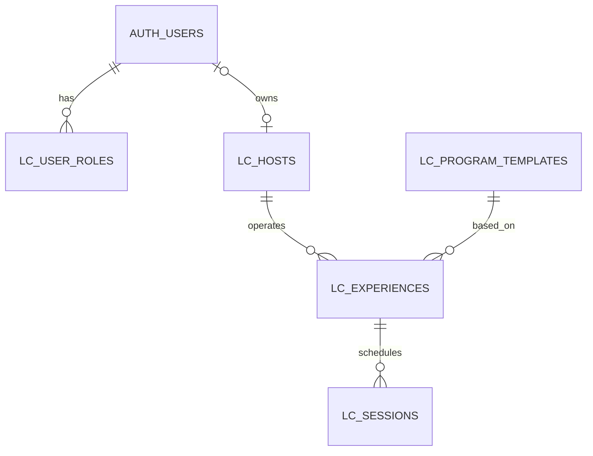

# 로컬이음 Supabase DB 설계 검토안

서비스: **여행, 한걸음** · 담당 모듈: **로컬이음(LOCAL EUM)** · 기준: 2026-10-15

이 문서는 PPT 12번 슬라이드의 **운영 회차 수정·저장**을 첫 구현 범위로 삼는 DB 설계다. 화면 배치는 시안을 참고하되 사용자 경험에 맞게 개선한다. 최초 다섯 테이블 스키마와 시연 데이터는 `local-eum-dev`에 적용되어 있으며, 현재는 화면 상단 문구를 Supabase에서 편집할 수 있도록 추가 설계를 검토한다. [기존 스키마 초안](initial_schema.draft.sql)과 [증분 마이그레이션 초안](migrations/20261016_host_studio_copy.draft.sql)은 서로 다른 시점에 적용하는 문서다. 새 마이그레이션은 아직 실행하지 않았다.

## 결정과 이전 자료 비교

| 쟁점 | 이전 Supabase 최종 기획서와 1차 작업명세 | 이번 결정과 이유 |
| --- | --- | --- |
| 호스트 테이블 이름 | `lc_hosts` | **`lc_hosts` 사용.** 앞선 점검의 `lc_host_profiles`와 같은 목적이므로 둘을 함께 만들지 않는다. |
| 역할 | `lc_user_roles`에 `HOST`·`ADMIN` | **유지.** Auth 계정과 업무상 권한을 분리한다. 한 사람이 두 역할을 갖는 경우도 표현한다. |
| 첫 화면에 필요한 테이블 | 역할, 호스트, 프로그램 원형, 체험, 운영 회차의 5개 | **이 5개만 최초 마이그레이션에 포함.** 참가 신청과 세부 경로는 해당 화면을 만들 때 추가한다. |
| 참가 신청 | 비회원 허용, 연락처 별도 보관 | **원칙 유지.** 첫 화면에 신청 데이터가 아직 없으므로 신청·연락처 테이블과 보호된 접수 API는 다음 마이그레이션으로 미룬다. 실제 운영 전에 반드시 구축한다. |
| 회차 단계 | `lc_template_steps` / `lc_session_steps` 후보 | **지금 만들지 않음.** PPT 12번에서 단계별 경로를 편집하지 않는다. 이후 경로 화면의 편집 방식이 정해지면 하나의 목적당 하나의 테이블을 정한다. |

여기서 **프로그램 원형**은 여러 호스트가 활용할 수 있는 공통 주제(예: “시장과 한국 음식”), **체험**은 특정 호스트가 맡은 상품(예: “전통시장 함께 걷기”), **운영 회차**는 그 체험의 특정 날짜·시간 한 건이다. 같은 숫자 `101`이 프로그램과 체험에 각각 나타나도 서로 다른 테이블의 PK이며 FK가 관계를 분명히 한다.

## 최소 테이블과 관계

| 테이블 | 왜 필요한가 | 연결 |
| --- | --- | --- |
| `lc_user_roles` | 로그인한 사람이 HOST인지 ADMIN인지 판단한다. 일반 가입만으로 HOST 권한을 얻지 못하게 한다. | `user_id → auth.users.id`; PK `(user_id, role)` |
| `lc_hosts` | 호스트의 공개 이름·소개, 승인 상태와 Auth 계정 연결을 보관한다. | `auth_user_id → auth.users.id`; PK `host_id` |
| `lc_program_templates` | 공통 프로그램 제목·기본 길이·기본 회비를 보관한다. | PK `template_id` |
| `lc_experiences` | 한 호스트가 공통 프로그램을 바탕으로 제공하는 체험을 표현한다. | `host_id → lc_hosts.host_id`, `template_id → lc_program_templates.template_id`; PK `experience_id` |
| `lc_sessions` | 화면에서 수정·저장하는 실제 운영 날짜, 정원, 회비, 장소와 모집 상태를 보관한다. | `experience_id → lc_experiences.experience_id`; PK `session_id` |

`auth.users`는 Supabase Auth가 제공하는 기존 테이블이며 로컬이음에서 다시 만들지 않는다. FK는 삭제 시 업무 데이터를 조용히 지우지 않도록 호스트·프로그램·체험에 `RESTRICT`를 사용한다. Auth 사용자가 삭제되면 역할 행은 제거되지만 연결된 호스트가 있으면 계정 삭제가 제한된다. 계정 탈퇴·보존 정책은 실제 운영 전에 별도 결정이 필요하다.

## 테이블별 컬럼

`bigint` PK는 `generated by default as identity`다. 따라서 나중에 시연용 ID 101/500/1을 명시할 수 있다. 시연 데이터 삽입 뒤 자동 번호 생성기의 현재값 조정은 별도 시드 작업에서 다룬다. 이 SQL 초안에는 INSERT가 없다.

### `lc_user_roles`

| 컬럼 | 형식 | 의미와 제약 |
| --- | --- | --- |
| `user_id` | `uuid` | 복합 PK, `auth.users.id` FK. |
| `role` | `text` | 복합 PK, `HOST` 또는 `ADMIN`만 허용. |
| `assigned_at` | `timestamptz` | 권한을 부여한 시각. |
| `assigned_by` | `uuid` | 권한을 부여한 Auth 관리자 ID, nullable FK. 최초 관리자 부트스트랩 때는 null 가능. |

역할 행의 삽입·변경·삭제는 브라우저에 허용하지 않는다. 최초 ADMIN은 프로젝트 소유자가 신뢰할 수 있는 서버/관리 절차로 지정해야 한다. 일반 가입 처리에서 `HOST`를 자동 부여하지 않는다.

### `lc_hosts`

| 컬럼 | 형식 | 의미와 제약 |
| --- | --- | --- |
| `host_id` | `bigint` | PK. |
| `auth_user_id` | `uuid` | nullable, unique, `auth.users.id` FK. 미연결 시연 프로필은 보관 가능하나 승인 불가. |
| `display_name` | `text` | 화면에 보일 이름, 공백 제거 후 1–80자. |
| `bio` | `text` | 소개, 선택. |
| `page_slug` | `text` | 공개 페이지 주소 일부, 선택·unique·소문자 영숫자/하이픈. |
| `approval_status` | `text` | `PENDING` / `APPROVED` / `SUSPENDED`, 기본 `PENDING`. 승인에는 Auth 계정 연결 필요. |
| `is_public` | `boolean` | 공개 여부, 기본 `false`. 승인된 호스트만 공개 가능. |
| `created_at` | `timestamptz` | 생성 시각. |
| `host_studio_title` | `text` | 호스트 스튜디오 상단 제목. 현재 문구를 기본값으로 사용하며 1–80자. 증분 마이그레이션에서 추가. |
| `host_studio_description` | `text` | 호스트 스튜디오 상단 설명. 현재 문구를 기본값으로 사용하며 1–240자. 증분 마이그레이션에서 추가. |

### 호스트 스튜디오 상단 문구

첨부 화면의 제목 **“운영 회차를 다듬어 볼까요?”**와 설명 **“운영 날짜와 시간, 모집 인원, 참가비, 장소를 한곳에서 확인하고 변경할 수 있습니다.”**는 `lc_hosts`의 `host_studio_title`, `host_studio_description` 두 컬럼에서 읽는다. 문구는 체험이나 회차별이 아니라 호스트 스튜디오별 설정이므로, 별도 콘텐츠 테이블을 만들지 않고 이미 호스트를 나타내는 `lc_hosts`에 저장한다.

기본값을 현재 화면 카피로 설정해 기존 호스트 행도 자연스럽게 표시한다. `authenticated`에는 두 컬럼의 SELECT/UPDATE 권한을 추가하지만, RLS 정책으로 HOST는 본인 호스트 행만 수정하고 ADMIN은 모든 호스트 행을 수정하도록 제한한다. 프로젝트 소유자는 Supabase Dashboard → **Table Editor** → `public.lc_hosts`에서도 해당 행을 수정할 수 있다. React는 컬럼이 있으면 DB 내용을 표시하고, 마이그레이션 적용 전처럼 컬럼이 아직 없으면 기본 문구를 표시하며 편집을 잠근다.

증분 SQL은 [호스트 스튜디오 문구 마이그레이션 초안](migrations/20261016_host_studio_copy.draft.sql)에 있다. 기존 `lc_hosts` 행을 지우거나 다른 테이블을 만들지 않는다. HOST/ADMIN 역할 부여 방식은 유지하고, 새 RLS UPDATE 정책은 본인 HOST 행 또는 ADMIN으로 문구 컬럼만 수정하도록 제한한다.

### `lc_program_templates`

| 컬럼 | 형식 | 의미와 제약 |
| --- | --- | --- |
| `template_id` | `bigint` | PK. |
| `title` | `text` | 공통 프로그램 이름, 1–120자. |
| `description` | `text` | 선택 설명. |
| `duration_min` | `integer` | 기본 진행 시간(분), 1–1440. |
| `default_fee_amount` | `integer` | 기본 회비(원), 0 이상. 회차의 실제 회비와 구분. |
| `is_active` | `boolean` | 공개 가능 여부, 기본 `false`. |
| `created_at` | `timestamptz` | 생성 시각. |

### `lc_experiences`

| 컬럼 | 형식 | 의미와 제약 |
| --- | --- | --- |
| `experience_id` | `bigint` | PK. |
| `host_id` | `bigint` | `lc_hosts.host_id` FK, 필수. 소유권 판단 경로. |
| `template_id` | `bigint` | `lc_program_templates.template_id` FK, 필수. |
| `title` | `text` | 호스트가 제공하는 체험 이름, 1–120자. |
| `description` | `text` | 선택 설명. |
| `region_code` | `text` | 지역 코드, 선택. 코드 체계는 실제 지역 검색 구현 전 확정. |
| `status` | `text` | `DRAFT` / `PUBLISHED`, 기본 `DRAFT`. |
| `created_at` | `timestamptz` | 생성 시각. |

### `lc_sessions`

| 컬럼 | 형식 | 의미와 제약 |
| --- | --- | --- |
| `session_id` | `bigint` | PK. |
| `experience_id` | `bigint` | `lc_experiences.experience_id` FK, 필수. 브라우저의 수정 권한 대상에서 제외. |
| `starts_at` | `timestamptz` | 시작 순간. 한국 시각 입력은 `Asia/Seoul`로 해석한 뒤 저장. |
| `ends_at` | `timestamptz` | 종료 순간. 시작보다 늦어야 함. 시작시간 변경 시 화면은 기존 진행 시간 또는 프로그램 기본 진행 시간을 유지하며 함께 갱신. |
| `meeting_place` | `text` | 공개 가능한 만남 장소, 1–200자. 정확한 개인 주소나 연락처는 담지 않음. |
| `recruit_deadline` | `timestamptz` | 모집 마감 시각, 선택. 시작 시각보다 늦을 수 없음. |
| `min_people` | `integer` | 최소 인원, 1 이상. |
| `capacity` | `integer` | 최대 인원, 최소 인원 이상. |
| `fee_amount` | `integer` | 그 회차의 1인 회비(원), 0 이상. 실제 결제 정보가 아님. |
| `status` | `text` | 첫 화면에서는 `DRAFT` / `RECRUITING`만. 확정·취소·변경 제안 상태는 신청 흐름 구현 때 별도 마이그레이션으로 확장. |
| `created_at` / `updated_at` | `timestamptz` | 생성/수정 시각. `updated_at`은 DB 트리거가 갱신. |

첫 구현에서는 참가 신청이 없는 **시연 회차**만 수정한다. 신청이 들어온 뒤 날짜·정원·회비 변경은 참가자 통지와 환불·동의 규칙이 필요하므로, 신청 기능을 열기 전에 DB/서버에서 변경 제한을 추가한다. 현재 다섯 테이블만으로는 “이미 신청자가 있는 회차”를 검사할 수 없다는 점을 숨기지 않는다.

## HOST·ADMIN 권한과 RLS 초안

Supabase Auth 로그인은 공통으로 사용하지만 기존 팀 Oracle 로그인 코드를 수정하거나 직접 연결하지 않는다. 팀이 공통 Supabase Auth를 사용하도록 합의하고, 승인된 호스트 계정과 `lc_hosts.auth_user_id` 및 `lc_user_roles`를 서버 측에서 연결하는 것이 선행 조건이다. HOST는 승인된 본인 체험의 회차만 읽고 수정하며, ADMIN은 관리 범위 전체를 읽고 회차를 수정한다. 같은 계정에 두 역할이 있으면 ADMIN 권한도 적용된다.

| 주체 | 읽기 | 쓰기 |
| --- | --- | --- |
| 비로그인 방문자 (`anon`) | 활성 프로그램, 승인·공개 호스트, 공개 체험과 모집 중 회차 | 이 첫 마이그레이션에서는 없음. 비회원 신청은 나중에 보호된 API로 허용. |
| HOST (`authenticated` + `HOST`) | 공개 데이터와 본인 호스트·체험·회차 | 승인된 본인 체험의 회차에서 날짜·시간·장소·인원·회비·상태만 수정. 다른 체험의 회차와 소유 FK 수정 불가. |
| ADMIN (`authenticated` + `ADMIN`) | 다섯 테이블의 모든 행. 호스트의 Auth 연결 UUID는 관리자 서버 전용 | 이 첫 마이그레이션에서는 회차의 허용 컬럼 수정. 호스트 승인·역할 부여·프로그램 관리는 추후 신뢰할 수 있는 관리자 경로에서 구현. |
| 일반 로그인 사용자 | 공개 데이터와 본인의 역할 행 | 없음. 로그인만으로 HOST가 되지 않음. |

다섯 테이블 모두 RLS를 켠다. `lc_private`의 권한 확인 함수는 RLS의 자기 참조를 피하기 위해 `SECURITY DEFINER`로 만들고, `search_path`를 비운 후 모든 객체를 스키마로 한정한다. 이 스키마는 Supabase Data API 노출 목록에 추가하지 않는다. 클라이언트에는 공개 가능한 조회 권한과 회차의 일부 컬럼에 대한 UPDATE만 부여한다. 비밀키와 `service_role` 키는 브라우저로 보내지 않는다. 정책은 선택/수정 행을 거르고, 컬럼 권한은 `experience_id` 교체 같은 수정을 막는다.

호스트 조회는 공개 가능한 컬럼만 명시해서 요청한다. 브라우저의 `select('*')`는 숨긴 `auth_user_id`까지 요구하므로 사용하지 않는다. 관리자 화면에서 Auth 연결값이 필요하다면 별도 신뢰할 수 있는 서버 경로로 읽는다.

비회원 참가 신청은 원칙 그대로 허용한다. 후속 단계에서 `lc_applications`(신청 상태·회차 연결)와 `lc_application_contacts`(비공개 연락처)를 추가하고, **Auth 계정이 없는 신청자**는 보호된 Edge Function 또는 서버 API를 통하게 한다. 공개 `anon INSERT`는 열지 않는다. 신청 시 중복 요청 방지, 정원 동시성, 속도 제한, 스팸 방지, 개인정보 보존 기간을 함께 검증한다. 이 두 테이블은 현재 다섯 테이블과 목적이 달라 중복이 아니다.

## 시연용 연결 예시 — 실제 INSERT 아님

| 객체 | ID와 예시 값 | 연결 |
| --- | --- | --- |
| 프로그램 | `template_id = 101`, “시장과 한국 음식”, 120분, 기본 회비 15,000원, 활성 | 공통 원형 |
| 호스트 | `host_id = 500`, 표시 이름 “시연 호스트”, 승인·공개 | 나중에 **테스트용** Supabase Auth 계정 UUID와 연결하고 `HOST` 역할을 신뢰할 수 있는 관리자 경로에서 부여 |
| 체험 | `experience_id = 101`, “전통시장 함께 걷기”, `host_id = 500`, `template_id = 101`, 공개 | 호스트와 프로그램을 연결 |
| 운영 회차 | `session_id = 1`, `experience_id = 101`, 2026-11-14 14:00–16:00 (`Asia/Seoul`), 최소 3명/정원 8명, 15,000원, `RECRUITING`, 공개 가능한 만남 장소 | PPT 12번 화면에서 수정할 한 건 |

테스트 Auth 계정이 생성되기 전에는 승인된 호스트 행을 만들 수 없도록 제약했다. 따라서 위 표는 **관계 예시**이며 실행 가능한 시드 SQL이 아니다. 실제 이름·전화번호·이메일·비밀키를 사용하지 않는다.

## PPT 12번 화면과 DB 대응

| 화면 항목 | DB 출처/저장 | 첫 구현에서의 동작 |
| --- | --- | --- |
| 상단 제목 “운영 회차를 다듬어 볼까요?” | `lc_hosts.host_studio_title` | DB에서 읽으며 아래 문구 편집 폼에서 수정·저장. 컬럼 적용 전에는 기본 문구를 표시하고 편집 잠금. |
| 상단 설명 “운영 날짜와 시간, 모집 인원, 참가비, 장소를 한곳에서 확인하고 변경할 수 있습니다.” | `lc_hosts.host_studio_description` | DB에서 읽으며 아래 문구 편집 폼에서 수정·저장. 컬럼 적용 전에는 기본 문구를 표시하고 편집 잠금. |
| 기본 프로그램 “시장과 한국 음식” | `lc_sessions.experience_id → lc_experiences.template_id → lc_program_templates.title` | 표시 전용. 변경하면 체험 전체에 영향을 주므로 회차 저장 폼에서 편집하지 않음. |
| 체험 이름 “전통시장 함께 걷기” | `lc_experiences.title` | 표시 전용. |
| 운영 날짜·시작 시간 | `lc_sessions.starts_at` | `Asia/Seoul` 기준으로 입력·표시. 저장 시 `timestamptz` 변환. |
| 종료 시간 | `lc_sessions.ends_at` | 화면에서 진행 시간을 보여주고 시작 변경 시 같은 길이를 유지해 함께 저장. |
| 최소 인원·최대 인원 | `min_people`, `capacity` | 정수 검증: `1 ≤ 최소 ≤ 최대`. |
| 1인 시연 회비 | `fee_amount` | 0 이상의 원 단위 정수. 프로그램 기본 회비와 구별. |
| 모집 상태 | `status` | 첫 단계에서는 `DRAFT` / `RECRUITING`. 공개 체험이 아닐 때 `RECRUITING` 저장 거부. |
| 만남 장소 | `meeting_place` | 공개해도 되는 장소명만 입력. |
| 저장 버튼 | `lc_sessions` 허용 컬럼 UPDATE | Auth 세션 확인 → `session_id`와 화면을 연 시점의 `updated_at`으로 조건부 UPDATE → 다시 SELECT하여 저장값 재표시. 다른 곳에서 먼저 수정했다면 충돌 메시지와 새로고침을 제공. RLS가 소유권 검사. |

더 읽기 쉽게 프로그램/체험은 화면 상단의 **읽기 전용 맥락 정보**로 두고, 편집 영역에는 회차 값만 배치하는 방향을 제안한다. 최종 UI는 구현 단계에서 미리보기와 함께 검토한다. 프론트엔드의 제한은 편의 기능이며 보안 판정은 DB 권한/RLS가 맡는다.

## 실제 구축 전 확인할 조건

1. 현재 승인 프로젝트는 `local-eum-dev` (`rhkaxmqdkztpbljkunxb`)다. publishable key만 프론트엔드 설정에 사용하며 비밀키는 브라우저에 넣지 않는다.
2. 최초 다섯 테이블과 시연 데이터는 적용되어 있다. 이 문서의 신규 스튜디오 문구 마이그레이션은 프로젝트 ID와 영향을 확인하고 사용자가 승인한 뒤에만 실행한다.
3. 추가하는 것은 `lc_hosts`의 문구 컬럼 2개와 authenticated SELECT 권한뿐이다. 신규 테이블, 행 삭제, HOST/ADMIN 역할 변경, RLS UPDATE 정책 변경은 포함하지 않는다.
4. React는 두 컬럼을 조회·수정한다. RLS는 HOST 본인 행 또는 ADMIN의 수정만 허용하며, column grant는 이 두 문구 외의 `lc_hosts` 컬럼 변경을 막는다. Table Editor에서는 프로젝트 소유자가 호스트 행을 직접 수정할 수도 있다.
5. Table Editor에서 바꾼 문구가 React 새로고침 후 보이는지 확인한다. Dashboard 편집은 높은 프로젝트 권한으로 동작할 수 있으므로, 이것을 HOST RLS 검증으로 간주하지 않는다.

현재 스튜디오 문구 SQL은 **초안이며 원격 DB에서 실행하지 않았다.** 최초 다섯 테이블과 시연 데이터의 기존 구축 상태는 유지한다.
